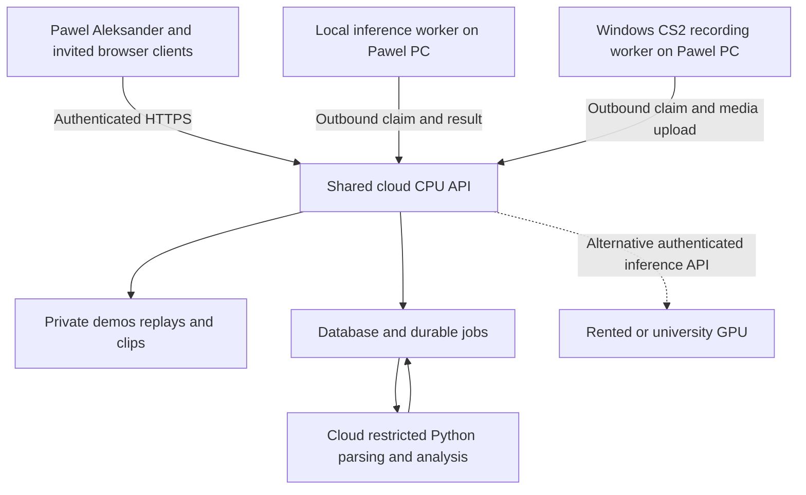

# Round Reviewer hosting and GPU experiment plan

Final architecture reference, 19 October 2026. Read with the authoritative [delivery plan and assigned backlog](FINAL-DELIVERY-PLAN.md). Invited-user access is required by 6 December; public access comes later. Pawel confirms the RTX 5080 PC is available and can remain online for testing. No infrastructure has been provisioned, no accounts changed and no money spent.

## Recommended deployment

The API and upload/parsing pipeline are required on a real shared cloud instance early, so Pawel and Aleksander can access the same backend concurrently. Local runs establish development baselines only. Keep Python parsing on the cloud CPU host; inference and Windows recording stay on Pawel's RTX 5080 PC. Frontend hosting is independent: the browser client can use this API without its own backend or a separate frontend hosting service.

The worker arrows show connection initiation. Jobs still flow from the hosted queue to the worker as responses to authenticated requests. The home PC needs no public inbound model or recorder port for this design. Keep the initial implementation to a polling worker and database-backed claims; do not add a message broker unless measurements justify it.

**20 October API/feedback research:** use the [recording and tactical-replay integration specification](RECORDING-AND-TRAINING-PLAN.md#21-both-visual-feedback-paths--research-and-proposed-integration-20-october) for the full sequence, context-window example, proposed worker endpoints, private storage upload, browser playback and assigned tasks. One main application API is sufficient; Azure/Google Windows recorders are outbound clients. Both recorded MP4 and browser-rendered tactical views attach to the same moment. These endpoints are a plan, not already implemented services.

| Stage | What runs where | User experience |
|---|---|---|
| Development baseline | Local test setup only | Measure resources and regression behaviour before deployment |
| Shared cloud proof, before defence | Cloud API/parser/metadata/artifacts; model and Windows recorder on Pawel's PC | Both students access the same backend from separate devices; no local parsing dependency |
| Invited friends | Same hardened cloud backend; lightweight browser Studio; local workers connect outbound | Upload in browser, immediate job status, radar/facts first, explanation and clips as ready |
| Public website, after submission | Reassess topology, capacity and operating budget after invited testing | No public registration or unrestricted processing commitment for 6 December |
| Independent hosting later | Move inference to university/rented GPU; move recording only after a separate feasibility test | Removes selected home-PC dependencies; each move has its own cost and validation |

Pawel will keep the RTX 5080 PC online for testing. RR37 deploys the cloud foundation by 24 October and RR08 proves cloud parsing by 29 October. RR21 hardens that deployment; RR22 tests outages. Uploads, parsing and numerical replay must continue when GPU workers are offline. Concurrent sessions do not require unbounded parallel parsing: queue CPU/GPU jobs within measured limits while keeping the API responsive. Public capacity is assessed after submission.

## What requires Windows and Steam

CS Demo Manager actually starts the game to render a clip. Its documentation supports CS2 recording on Windows and Linux; HLAE is specifically Windows-only. Preserve the current Windows/HLAE route for the project because it matches the existing implementation. Linux recording is a possible separate experiment, not a drop-in replacement. [Video documentation](https://cs-demo-manager.com/docs/guides/video)

The CLI supports selected tick ranges, player focus and config-file recording, and expects the demo to have been analysed into its database. This fits a queued recording adapter. [CLI documentation](https://cs-demo-manager.com/docs/cli)

Worker setup: Pawel's RTX 5080 Windows machine, functioning graphics session/driver, Steam/CS2, CS:DM and its database, HLAE and FFmpeg/ffprobe. RR03/RR20 verify actual login/session behaviour, display requirements, locks, restarts and reconnects. Do not assume a headless service or locked remote session behaves like an interactive desktop.

Steam authentication remains on the operator's machine. Website users upload demos, not Steam credentials. CS:DM database setup is a recorder implementation detail; it does not force a matching database choice for the application.

A cloud GPU sold for AI inference is not automatically a usable Windows game-recording host. Only consider moving the recorder after verifying the OS/image, graphics/session support, game installation/login, available disk, capture output and idle billing. This is outside the $30 inference experiment.

## Azure / Google recording feasibility — research, 20 October 2026

**Conclusion:** Windows GPU recording is a plausible cloud deployment, but the complete CS2/Steam/CS:DM workflow has not been tested on either provider here. Keep the shared cloud API/parser requirement and the local RTX 5080 recorder baseline. Run a bounded cloud recorder experiment before making it a delivery dependency. Three.js is an optional tactical view, not a faithful replacement for engine-rendered POV. This research does not remove recorded clips from the agreed delivery scope.

### Candidate services

| Candidate | Evidence and starting configuration | Unresolved gate |
|---|---|---|
| Azure Virtual Machines, NVadsA10v5 | Graphics/virtual-desktop family with GRID licensing included. `Standard_NV6ads_A10_v5`: 6 vCPU, 55 GiB RAM, fractional A10 with 4 GiB framebuffer; NV12 has a larger GPU slice and 8 GiB framebuffer. Start with NV6 only if the quote and availability justify it; resize only after measuring. | CS2 recording throughput, supported image/graphics driver, Windows client-image licensing if used, regional quota/capacity and unattended session behaviour. |
| Google Compute Engine, G2 + NVIDIA L4 virtual workstation | Google documents a Windows Server 2022 display-capable GPU workstation and qualified NVIDIA vWS drivers. Its example uses `g2-standard-8`; use the virtual-workstation configuration rather than assuming an AI GPU image provides display support. | CS2 compatibility on that Windows Server image, recording reliability, vWS/Windows charges, quota and capacity. |
| Google Vertex AI | Model inference/training service; custom inference containers expose an HTTP model server. | It is not the appropriate service for the Windows Steam/game-rendering worker. Use Compute Engine for this role. |
| Existing RTX 5080 PC | Existing hardware and the agreed baseline; worker can poll the cloud API and upload clips. | Real capture preflight still required. Availability and contention with inference must be measured. |

Sources: [Azure NVadsA10v5](https://learn.microsoft.com/en-us/azure/virtual-machines/sizes/gpu-accelerated/nvadsa10v5-series), [Azure graphics drivers](https://learn.microsoft.com/en-us/azure/virtual-machines/windows/n-series-driver-setup), [Windows desktop image eligibility](https://learn.microsoft.com/en-us/azure/virtual-machines/windows/windows-desktop-multitenant-hosting-deployment), [Google Windows GPU workstation](https://docs.cloud.google.com/compute/docs/virtual-workstation/windows-gpu), [Google vWS drivers](https://docs.cloud.google.com/compute/docs/gpus/install-grid-drivers), [Vertex custom inference containers](https://docs.cloud.google.com/vertex-ai/docs/predictions/use-custom-container).

The provider documentation establishes graphics VM support, not end-to-end CS:DM certification or expected frames per second. Valve lists Windows 10 in CS2's minimum requirements, rather than certifying these Windows Server images. Treat game launch on the selected image as an early gate. [CS2 requirements](https://store.steampowered.com/app/730/)

### What actually runs on the worker

Install the supported graphics driver, Steam and CS2, CS Demo Manager with its PostgreSQL dependency, HLAE and FFmpeg. CS:DM must analyse the demo into its database before recording the requested ticks/player. Its CLI removes the need to operate the manager GUI manually; it does not remove the game renderer. Keep Steam authentication on the worker, never in website uploads. [CS:DM CLI](https://cs-demo-manager.com/docs/cli), [installation](https://cs-demo-manager.com/docs/installation).

Provision roughly 256 GiB of persistent disk as an initial engineering estimate, then measure actual use: CS2 alone lists 85 GB, with Windows, downloads, updates and capture scratch space additional. Azure's advertised local temporary disk is not durable storage. Use HLAE/FFmpeg for the current Windows route to avoid the raw-image sequence overhead. CS:DM also supports Linux recording; Windows-only applies to HLAE, not the whole product. Game updates can break capture compatibility. [Video guide](https://cs-demo-manager.com/docs/guides/video).

The worker should claim a job, download its demo, record selected short windows, validate and upload clips, then release its lease. Keep recording off the API request thread and run one recording at a time initially. Validate lock, disconnect, reboot, login and recovery behaviour explicitly; an ordinary background service is not evidence that the graphics/session requirements are satisfied.

### Cost boundary

No account, quota, region availability or complete VM quote was inspected. Public Azure retail pricing and Google's detailed accelerator price table were not retrievable through this research tool, so no all-in hourly price or provider-cheapest claim is made.

Google currently lists Windows Server image licensing at **$0.046 per visible vCPU-hour** for these machine types. For eight vCPUs that is **$0.368/hour**, or **$268.64 over 730 running hours for Windows licensing alone**, before the machine/GPU, vWS, disk, network and taxes. This is an illustration for Google's standard Windows image billing, not an Azure quote or a complete Google quote. [Image and disk pricing](https://cloud.google.com/compute/disks-image-pricing).

Therefore treat the existing $30 GPU allowance as a short experiment only; do not assume it can also fund an always-on Windows renderer. Record the full regional quote before provisioning and agree how much of the existing inference experiment budget, if any, can be reassigned. Include setup/download hours. Use a timed stop/deallocation procedure; billing alerts are not a hard spending cap. Azure guest shutdown can leave the VM allocated and billed; deallocation stops compute billing while other resources can still cost money. [Azure billing states](https://learn.microsoft.com/en-us/azure/virtual-machines/states-billing).

### Three.js: useful tactical reconstruction, different evidence

**Pawel's clarification, 20 October:** the intended feature is an existing 3D map with simple player locators/arrows, look direction and a small weapon indicator. It is an addition or fallback when VM recording fails, not a first-person camera or recreation of CS2. This narrower scope is a credible fallback candidate. Camera-origin research, character animation, engine effects and faithful POV are not prerequisites. The earlier caution about a full renderer does not reject this feature.

Current source inspection: `apps/api/app/processing/parse_demo.py` samples full-round X/Y/Z, yaw, health, team and alive state; `time_utils.py` sets 8 Hz. `SamplePlayerState` in `models/contracts.py` retains position/yaw but no full-round pitch or eye-camera origin. Dense pre-kill analysis has additional properties, which do not constitute a complete camera stream.

This supports generic player markers/capsules, headings, paths, height differences and an orbiting tactical camera. Interpolation can smooth movement at the display frame rate; it cannot restore unsampled detail. Reuse the Studio playback clock, snap discrete events, validate coordinate transforms against landmarks, and keep the 2D radar available.

#### Minimal tactical fallback implementation

| Feature | Data and implementation | Lead |
|---|---|---|
| Map and player locations | Begin with one version-identified Ancient GLB/glTF, validate position/height/rotation against at least four landmarks, and render ten simple markers. Browser renders; cloud still parses and serves replay data/assets. | Pawel |
| Look direction | Use existing yaw for horizontal heading. Add nullable full-round pitch to parser, normalisation and Python/TypeScript contracts for vertical aim; missing pitch means unknown, not a silently invented angle. | Pawel |
| Weapon indicator | Add nullable `active_weapon_name` to full-round replay sampling and contracts. Start with a simple gun silhouette/category plus exact weapon label where available; detailed weapon meshes are optional. Equipped state changes discretely. | Pawel |
| Actions | Expose tick-stamped `weapon_fire` events already collected for analysis through an appropriate replay contract. A short firing pulse comes from an event, not from the held weapon or movement. Do not draw an inferred hit/trajectory as fact. Reload/throw animations require their own validated evidence and can wait. | Pawel; Aleksander checks interpretation |
| Playback and visibility | Reuse the shared clock for seek, pause, speed, radar and selected coach moments. Orbit/zoom and player focus; clip/hide obstructing map geometry where needed to see indoors. Keep marker selection usable and 2D radar available if assets or graphics fail. | Pawel |
| Validation | Compare real demo positions, headings, weapon changes and fire events across known ticks. Test reverse seeks, round boundaries, death/respawn, missing fields, map mismatch, camera occlusion and measured browser load/memory/frame time. | Both |

Upstream demoparser documents pitch and active weapon properties, but verify extraction on the pinned dependency and real demos before promising coverage. Existing replay samples omit those fields; pre-kill dense data alone is insufficient. [demoparser documentation](https://github.com/LaihoE/demoparser).

The first milestone is one real round on one calibrated map with markers, headings and the existing timeline. Add weapon/action evidence next, then Anubis only after that milestone passes. Ancient and Anubis replace the earlier three-map scope by Pawel's 25 October decision. This is a functional feasibility step while visual design remains paused. No 3D renderer or 3D map asset integration has been performed.

Use a downloaded community map only after checking its map revision, source, usable format, redistribution terms and size; a visually recognisable map may be rescaled or modified. Prefer hosting a verified optimised copy over depending on an external asset URL. Source 2 Viewer export is an alternative if no suitable ready-made asset is found. Three.js provides a glTF loader; asset preparation and calibration remain the main uncertainty, rather than the ten player markers. [Three.js GLTFLoader](https://threejs.org/docs/pages/GLTFLoader.html).

Source 2 Viewer can export map geometry to glTF for a browser asset pipeline. That does not recreate Source 2's gameplay rendering. Map versions, asset size, coordinate calibration, materials, distribution permissions and browser performance need separate checks. [Map export guide](https://s2v.app/ValveResourceFormat/guides/exporting-maps.html), [format support](https://s2v.app/ValveResourceFormat/guides/format-support.html).

Position-only rendering cannot establish the player's exact view through smoke/flashes, weapon animation/recoil, audio cues or precisely what they could know. Even engine-rendered demo POV is a reconstruction, not the original client screen recording. Label tactical reconstructions honestly and do not let the coach equate omniscient positions or static raycasts with player knowledge. See the historical [Three.js research](../reference/phase1/THREEJS-RESEARCH.md).

### Bounded experiment and decision

This expands the feasibility work in RR03/RR20; it is a recommendation, not completed work or an extra mandatory platform build.

1. **Pawel:** establish real local recording first with one known demo and selected player/ticks; save versions, actual video and timings. Stubs do not pass.
2. **Pawel:** check university access, image eligibility, GPU quota and complete quote. Select one cloud provider only. Prefer Azure NVadsA10v5 if an eligible image, quota and quote are readily available; otherwise consider Google's documented G2 workstation route. Neither is assumed cheaper.
3. **Pawel:** allow at most two working sessions for the first cloud attempt, within a separately agreed portion of the spending allowance. Use 720p/30 fps and short clips initially. Stop if installation/session issues consume the allowance.
4. **Both:** review ten clips across Ancient and Anubis. Include correct POV/ticks, readable media, event alignment and repeated jobs. Pawel tests remote disconnect, lock, reboot and failed-job recovery; Aleksander judges whether clips add useful evidence to telemetry-based explanations.
5. **Pawel:** record setup time, wall time per clip, failures/manual interventions, disk use and billed cost. Repeat capture after restart; a single successful manual export does not pass unattended hosting.
6. **Decision:** if reliable and affordable, move the existing worker interface to the VM. If it fails, local recording remains available, and the clarified minimal 3D tactical replay is the proposed browser fallback. Validate that small feature independently; do not expand it into a full game renderer.

If the recorder must operate independently of Pawel's PC and cloud recording fails, the minimal tactical view can substitute for the unavailable recording in the review workflow, once validated. Label it as tactical replay and disclose any undelivered recorded-clip requirement in the university presentation. This does not remove the separate local inference dependency. Pawel has clarified the fallback direction; wholesale removal of recorded clips from the university deliverable has not been decided.

## Worker protocol and acceptance checks

Each job carries a generated job ID, authorised artifact ID, match/player scope, stage, versioned input, lease expiry and attempt number. Recording jobs add validated start/end ticks and an allowed capture profile. Resolve fixed executables and file destinations on the worker; jobs never carry arbitrary shell commands or filesystem paths.

1. Worker authenticates with a revocable credential and claims one allowed job.
2. API grants a bounded lease and access only to that job's inputs.
3. Worker validates input hashes, reports a heartbeat and writes to a fresh attempt directory.
4. On success, worker uploads results; API validates the manifest and publishes atomically.
5. Retry or expired leases must not publish duplicate/stale results. Cancellation stops only owned work.
6. API restart and worker disconnect leave recoverable job states. Test deliberately with the network disabled and each process restarted.

Start with one GPU task at a time across inference and recording. Measure model memory residency and CS2 contention; unloading/reloading the model may be needed. If model inference moves to another GPU, this restriction can be revised using measured evidence.

The recording gate includes correct player, tick window, media readability and event alignment. A valid MP4 alone is not sufficient. The remote acceptance gate also tests user isolation, private media, upload limits, storage cleanup and worker credential revocation.

## Local model and cloud API options

Use the existing model client behind a configuration boundary. The Studio talks only to your API; provider credentials stay on the backend. Never silently replace local inference during a research run. Store model identity, weights/quantisation, prompt, serving configuration, hardware, timings and fallback reason.

| Option | Use | Research interpretation |
|---|---|---|
| Local llama.cpp on Pawel's GPU | Primary baseline and initial product | Direct evidence for the consumer-hardware viability question |
| Your chosen model deployed on a rented GPU | Controlled comparison or temporary inference capacity | Self-managed model on rented hardware; repeat the same workload first |
| University GPU | Alternative hosting/training capacity | Record its hardware and configuration separately; check availability and software permissions |
| Provider's managed model endpoint | Possible separately labelled API fallback/comparison | Not evidence of running the model yourselves; exact weights, tuning and feature parity may differ |

SimplePod publishes an OpenAI-compatible managed inference endpoint as well as compute-rental APIs. These are different products: rental can let you serve your chosen model; a managed endpoint serves the provider's offered model. Confirm tool calling, structured output, streaming, model/version and adapter support before choosing either. [SimplePod API documentation](https://api.simplepod.ai/docs_ai.html)

## A $30 total experiment

Treat $30 as an experiment target. Suggested envelope: $5 setup/smoke, $17 measured runs, $8 storage/tax/other charges and contingency. Do not treat the reserve as guaranteed to cover every fee, and do not buy an always-on service from this budget.

Runpod's public list checked 19 October 2026 shows RTX A6000 48 GB at $0.59/hour, RTX 4090 24 GB at $0.89/hour and RTX Pro 6000 96 GB at $2.49/hour. These are displayed rates, not a reservation or guaranteed checkout quote. As an illustration, eight compute hours on A6000 plus eight on 4090 totals $11.84 before additional charges. Availability and final price must be rechecked. [Runpod pricing](https://www.runpod.io/pricing)

Recommendation: test locally first; then pick one rental based on measured needs. A 48 GB candidate is worth considering when memory blocks the experiment; a 24 GB candidate may suffice for inference. Do not promise that a QLoRA run fits or finishes without its model, sequence length and batch configuration being measured.

Persistent storage can remain billable after stopping compute. Export results/adapters, verify their local copies, and check which resources must be stopped or deleted to end billing. Do not rely on account balance reaching zero as the experiment's termination mechanism. [Runpod billing/storage documentation](https://docs.runpod.io/pods/pricing)

SimplePod's public pricing page did not expose readable live rates in this research pass, so no comparative price claim is made. Obtain a dashboard quote covering GPU, storage and minimum payment before selecting it. [SimplePod pricing](https://simplepod.ai/pricing)

Prepare the dataset, evaluation command, model download/cache instructions and export procedure before starting the meter. Save startup and download time as costs too. Compare: same model locally and remotely; only then optionally compare a larger model. Report inference latency, total review latency, correctness/usefulness, peak VRAM and total experiment cost separately.

The $30 target is for GPU experiments. Website hosting, demo/video storage, network use and sustained public operation need a separate budget or university resources. No claim of free or unlimited public hosting is made.

## University resource enquiry

Ask about a CUDA-capable GPU with 24–48 GB VRAM as a starting candidate, available RAM/disk, maximum job duration, shared scheduling, container or Python environment access, model downloads, handling of uploaded demos and permission to serve an authenticated endpoint. These are requested capabilities, not guaranteed model requirements.

A compute cluster with batch jobs can still run evaluation/fine-tuning even if it cannot host a public API. Ask separately about a Windows graphics workstation if recording capacity is needed; an AI training allocation does not imply CS2/Steam support. No enquiry has been sent on your behalf.

## Implementation tasks and timing

The RR backlog in the final delivery plan is authoritative. The earlier H task IDs below are retained only as a cross-reference, with owners and deadlines reconciled. They are not separate estimates or a second status board.

| Old ID | Canonical tasks | Lead | Deliverable and acceptance | Target |
|---|---|---|---|---|
| H01 | RR03, RR04 | Pawel; Aleksander for model | Real parse, model/tool run, real clip and stage/GPU measurements | 22 Oct |
| Cloud foundation | RR37, RR08 | Pawel; Aleksander validates | Shared HTTPS API by 24 Oct, cloud parsing by 29 Oct, concurrent access from both devices; home workers not needed for parsing | 24–29 Oct |
| H02 | RR07, RR09 | Pawel | Scoped claims, heartbeat, expiry, idempotency and cancellation | 2 Nov |
| H03 | RR15, RR20, RR21 | Pawel; Aleksander for inference | Hosted jobs, reconnect/restart recovery and shared GPU admission | 12 Nov |
| H04 | RR21, RR22 | Pawel | Private transfers, owner-scoped replay/media, offline and overload UI | 13 Nov |
| H05 | OPT01 | Aleksander | Fixed inputs, current quote, endpoint test and cost/export/shutdown procedure | Before optional paid run |
| H06 | OPT01 | Aleksander | Recorded comparison and charges; saved outputs; idle billing checked | Ideally 24 Nov; P1 |
| H07 | RR30, RR31, RR34, RR35 | Aleksander for study; Pawel for release | Invited testing, operational fixes and reproduced final release | Study 18–24 Nov; sign-off 5 Dec |

Remaining operational actions have owners: Aleksander records course expectations/resource enquiries in RR02; both reconcile capacity on 22 October; Pawel selects the cloud CPU host and documents cost/availability in RR37. RR21 subsequently hardens it. The shared cloud API/parser is mandatory; GPU rental and public registration are not. No actual host purchase or deployment has occurred during planning.
