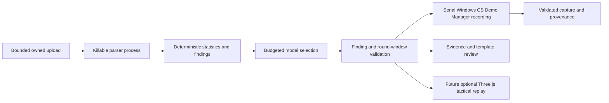

# Round Reviewer: implementation plan and bounded agent prompts

Updated 13 October 2026. Phase 1 is implemented in this working tree; exact validation and remaining limits are in `PHASE1-RESULTS.md`. The earlier `APP-REVIEW.md` and `VALIDATION.md` describe the original audit snapshot. This plan preserves numerical analysis → model moment selection → Windows CS Demo Manager/HLAE recording. Project context and memory remain yours.

## Architecture and sequence



The model receives a candidate table and numerical evidence. Application code downloads/stores/parses artifacts and invokes approved recorder arguments. Selection cannot construct shell commands, choose executable paths, change the bound player, or create new gameplay facts. A deterministic ranker remains the fallback. Three.js consumes the same ticks and events; it does not become an event detector or replace the Windows recorder in Phase 1.

| Stage | Deliverable | Gate before proceeding |
| --- | --- | --- |
| 1: personal reliability | Access boundaries, bounded work, durable state, score/death corrections, fresh validated media, dependency fixes | Synthetic regression suite and frontend build; real-demo/recorder smoke test remains necessary |
| 2: numerical quality | Parser capability manifest, supported detector features, labeled real-demo corpus | Manually checked events/rounds and measured detector precision |
| 3: model evaluation | Frozen candidate selection benchmark; smaller model comparison; typed claims | Human selection usefulness, unsupported claims, fallback rate, language quality and VRAM measured separately |
| 4: Windows worker | Durable recording lease, owned process/session lifecycle, batch recording, timeline alignment | Known-player/window recordings measured against event ticks and restart recovery |
| 5: tactical 3D | Versioned telemetry, tested transform, optional scene, calibrated map | Correct seek/event state, verified map alignment, resource and device measurements |
| 6: public beta | Accounts, scoped workers, quotas/retention, private object storage, HTTPS, isolation and recovery | Adversarial integration tests, backups and load/failure drill |

Phases can overlap only where inputs are independent. A renderer built on synthetic fixtures can proceed alongside corpus evaluation. A real-map view depends on calibrated assets. Public release depends on identity and worker isolation, not on having a polished renderer.

## Model policy for implementation agents

The three worker agents used here ran `gpt-6-luna` with high reasoning, each with a narrow brief and exclusive source ownership. They handled scoring/replay, coach limits, media capture safety, dependencies, regression tests, MCP access and primary-source 3D research. The coordinator handled shared access/storage/parser boundaries and integration. Their assignments were reused for focused follow-ups, with tests and findings returned before integration.

Use the lower-cost model first for bounded implementation, fixtures, documentation and source research. The coordinator supplies the contract, checks diffs and validates integration. Escalate only a specific unresolved problem: contradictory source conventions, a repeatable concurrency failure, or an implementation that fails its acceptance tests twice. Give the stronger model the failing evidence and one question, rather than the entire app for a rewrite. Research outputs require primary links and a distinction between documented behavior and proposed design. No agent may claim live CS2 success from a mocked recording test.

Use at most three workers concurrently. Independent files can be parallel; a shared contract or package lock has one owner. A dependent worker starts after the producer returns its contract/test fixture. Every worker returns changed paths, behavior, commands/results, unresolved findings and assumptions. Avoid overlapping edits, speculative refactors and implementation-mirroring tests.

## Dispatch template

```text
Task: [one concrete behavior]
Model: gpt-6-luna; reasoning high for code/security, medium for bounded documentation.
Inputs: [exact source paths, fixture and accepted upstream contract].
Own: [exclusive paths]. Read other files as needed; send findings to the coordinator.
Preserve: numerical detectors, model selection, Windows recorder, user context/memory,
          existing unrelated edits/deletions and fallback behavior.
Implement: [observable before/after behavior and failure behavior].
Out of scope: unrelated refactors, paid hosting, live model/game startup and deployment.
Acceptance: [meaningful regression, build/typecheck and concrete measured limits].
Return: changed paths, test commands/results, assumptions and unresolved failures.
Do not report completion while a required acceptance check fails.
```

## Next small work packages

### N1 — parser capabilities and selected-window telemetry

Prompt: Read `review/skills/rr-parser/SKILL.md`, `THREEJS-RESEARCH.md`, parser properties and current replay contracts. Keep demoparser2. Add an explicit capability report for extracted fields and a separate bounded selected-window telemetry product carrying absolute tick, position, pitch/yaw, velocity and supported stance/weapon fields. Probe property support on one supplied local demo; missing fields are nullable and listed as unavailable. Preserve the existing 8 Hz round replay and numerical analysis input. Never guess a camera eye offset.

Owner: `parse_demo.py`, `analysis/extract.py`, one new telemetry module and parser fixtures/tests. A separate contract owner approves Python/TS schema changes before implementation. Depends on a supplied local demo and frozen telemetry schema. Acceptance: selected tick/window bounds and byte cap, optional-field handling, event alignment, reported parse/storage cost, existing detector tests pass. Escalate only unsupported native-property behavior with a minimal reproduction. No parser replacement without a benchmark.

### N2 — numerical detector evaluation

Prompt: Read `rr-detector` and `rr-eval`. Build a small labeled corpus manifest for supplied demos covering side switches, overtime, disconnects and truncated inputs. For one detector at a time, state required features, mark missing data, and compare detector observations to manual review. Keep severity separate from evidence confidence. Begin with the misleading dry-peek interpretation; do not infer visibility or intent from death alone.

Owner: one detector module per dispatch, its tests and `eval/numerical/` output schema. Depends on human labels and feature capabilities. Acceptance: reproducible true/false positives, denominator and precision, missing-feature result, no unsupported event invention. This is several individual tasks, not a broad detector rewrite.

### M1 — smaller selection model benchmark

Prompt: Read `rr-eval` and the existing comparison harness. Freeze candidate tables, actual round durations and human preferred moments. Compare the existing Qwen/Gemma baseline with Ministral 3 8B, Phi-4-mini and, when memory permits, larger candidates from `RESEARCH.md`. Measure schema/constraint success, useful diversity, omitted important moments, repair/fallback rate, p50/p95 latency and actual peak VRAM. Test EN/PL/NL prose separately; do not rank selection quality by citation acceptance. Do not start downloads or paid inference unless explicitly included in the supplied benchmark task.

Owner: `eval/` harness adapters and benchmark manifest only. Depends on labeled fixtures. Acceptance: same inputs/config recorded for every run; repeatable CSV/JSON metrics; recommendation chooses the smallest model meeting measured thresholds. Keep the current app model configurable until this data exists. On this 16 GB GPU, quantized 8B/14B candidates are trials, not promises of throughput or available context length.

### M2 — typed claims before generated prose

Prompt: Read `rr-coach`, current verifier, jobs and source labels. Define a claim schema with subject, round/tick, event/stat field, value/unit and evidence reference. Validate each factual claim against its exact field and scope before rendering text. Reject contradictory outcome/player/round claims, even if another evidence item contains the same number. Keep deterministic templates default until the evaluation establishes the new path's limits; retain model selection and limited citation checks.

Owner: new claim validator, contracts and focused tests; jobs integration is a separate dependent task. Acceptance: adversarial winning/losing duel, same-number wrong-stat, wrong player/round, unsupported visibility and invented knowledge citations fail. Supported observations pass; interpretations retain explicit uncertainty. No broad claim of semantic proof.

### R1 — owned Windows recording session

Prompt: Read `rr-recording` and current capture code. Introduce one durable host recording lease and attempt identity. Determine how CS:DM launches or attaches to CS2/HLAE before choosing process cleanup. Use Windows job objects or another verified ownership mechanism only for processes launched by this worker. A timeout must stop owned encoding/recording work while preserving unrelated Steam/CS2 sessions. Keep fixed executable configuration and numeric job inputs.

Owner: new Windows worker/session module and recording adapters/tests; repository lease schema is coordinated separately. Depends on actual CS:DM launch behavior. Acceptance: single recording claim, expired lease recovery, cancellation/timeout with no orphan owned encoder, restart retry, no other-session termination. Mock tests precede one operator-run live smoke test. Do not assert process-tree cleanup from the current direct subprocess timeout.

### R2 — capture profile and clock alignment

Prompt: With a supplied real demo and approved recording setup, compare 720p30 preview with 1080p60 for selected aim moments. Record requested and actual ticks, focused SteamID, first-frame event offset, stream metadata and recorder versions. Measure several known shots/deaths rather than accepting duration alone. Test the current official CS:DM batch/config interface before adopting it. Show numerical review while clips finish as a separate UI task.

Owner: recorder profile/manifest adapter and alignment harness. Depends on R1 and live recorder availability. Acceptance: correct player and segment; no stale capture; duration/FPS/dimensions correct; measured start/drift error; reruns reproducible. Proposed ≤100 ms targets remain unmeasured until this work runs.

### T1 — pure transform and deterministic world state

Prompt: Read `rr-replay-3d` and `THREEJS-RESEARCH.md`. Implement pure Source-to-world point/forward transforms from a manifest, initially using candidate `(X,Z,-Y)` and Source-unit conversion. glTF specifies meters; validate export conversion rather than scaling twice. Add tick-based world evaluation and indexed event lookup. Keep HP, death, weapon and stance discrete. Handle gaps and life/round resets explicitly.

Owner: new `worldTransform.ts`, `worldState.ts` and synthetic tests. No renderer or assets. Depends on frozen telemetry/map manifest contracts. Acceptance: axis/forward test vectors, yaw wrap, exact death tick, direct/reverse seek, missing frames, round clamping and long gaps. Transform remains labeled uncalibrated until T2.

### T2 — one local map package and calibration

Prompt: Read the linked Source 2 Viewer export/fidelity docs. Use an operator-provided Mirage export to produce a hashed map manifest, root-transform report and landmark calibration. Verify scene scale/axes against spawns and radar; solve using three landmarks and hold out a fourth. First load the unoptimized GLB; then compare an optimized copy with meshopt/KTX2. Keep map name, game/exporter build and asset provenance explicit.

Owner: offline `tools/map-assets/` scripts, manifest validator and calibration report. Depends on supplied game assets and redistribution decision. Acceptance: known geometry bounds, no duplicate axis/unit conversion, missing texture/decoder detection, declared calibration residual and map-version fallback. No game file extraction or redistribution is implicit in this research plan.

### T3 — optional tactical scene

Prompt: Use stable R3F 9.8.1 with the app's React 19.3; verify compatible Three/Drei versions at implementation time. Create one lazy client canvas using WebGL2, generic instanced capsules and the existing playback clock. Begin with a synthetic floor and fixture, then a calibrated map. Mutate scene objects per frame rather than React state. Dispose resources through an explicit cache owner. Label the view Tactical replay and preserve Radar/Gameplay.

Owner: new world replay components and package files exclusively. Depends on T1; map loading waits for T2. Acceptance: no initial-route 3D bundle, deterministic seek, one active canvas, no resource growth after repeated switching, DOM/keyboard/reduced-motion fallback, measured desktop/mobile frame/seek times. World-view integration in Studio is a separate owner after the component contract is returned.

### T4 — optional render export experiment

Prompt: After T3 is correct, test same-origin canvas capture and supported browser codecs. Clearly distinguish real-time MediaRecorder output from frame-exact offline export. If offline capture is required, define a fixed tick/frame scheduler plus encoder process and test frame count, timestamps, audio and event alignment. Preserve CS:DM for game-faithful POV.

Owner: one export adapter/harness, no parser changes. Depends on T3, a calibrated map and measured browser capability. Acceptance: deterministic output where claimed, bounded memory/duration, correct media probe and provenance. No smoke, visibility, animation or audio fidelity claims beyond supplied state.

### D1 — limited cloud beta preparation

Prompt: Read `rr-deployment` and `PHASE1-RESULTS.md`. Prepare a priced EU CPU-hosting plan under €30/month, keeping local GPU inference and Windows recording behind an outbound job worker. Implement proper account sessions, owner-scoped object access, per-user quotas/retention and worker leases before deployment. Treat Phase 1 owner tokens as a private testing bridge, not an account system. Configure HTTPS and same-site browser/API routing, backups and restore drill. Refresh provider prices from official pages at execution time.

Owner: deployment manifests/runbook; accounts, storage and worker protocol are separate bounded tasks. Acceptance: no public anonymous artifacts/tools, cross-owner failures on every endpoint and retry, request/queue limits, verified restore and cancellation, idle-cost estimate including storage/egress. No paid infrastructure creation from this implementation-plan task.

## Runtime cost policy

Run parsing, stats, scoring, validation, rendering and templated text without a model. Use one compact selection request per match/player, with at most one repair and a deterministic ranker fallback. The current cap is 4,096 output tokens across attempts, 12 tool calls, 256 KiB tool results, a 120-second job deadline and one concurrent model job. A thinking model can consume the token budget before its final JSON; measure and tune this using M1 rather than disabling constraints.

Use the local GPU for personal tests. Try a smaller model before switching the configured baseline. Escalate to a larger model only for labeled quality failures, and keep its result bound to the same evidence/validator. Use hosted API calls only as measured benchmark samples with an explicit budget cap; a continuously rented GPU is outside this testing budget. This plan adds no memory service and changes no user-maintained context.
