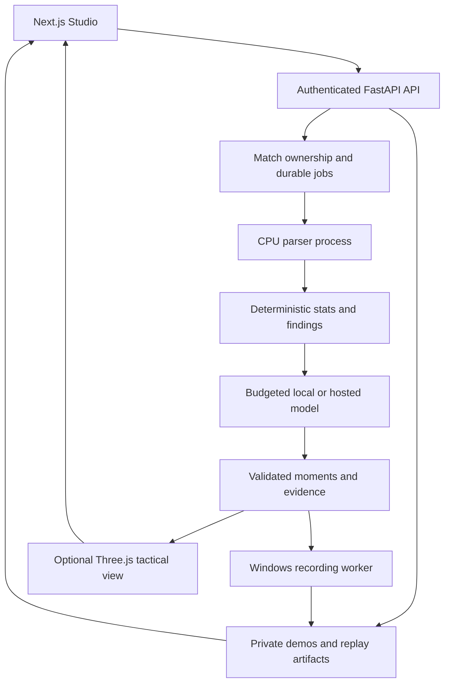

# Round Reviewer application plan

Keep the current product idea: turn demo telemetry into a short review of useful good and bad plays, then record those selected windows through CS Demo Manager on Windows. Develop locally on your existing PC, make the numerical evidence trustworthy, and separate the recording worker before moving the public API to cloud hosting. Context and memory are supplied and maintained by you.

## Product behavior

1. Upload a `.dem` or `.dem.zst`, with a visible size limit and upload progress.
2. Validate the demo, parse it and expose the radar as soon as replay data is ready.
3. Choose the player. Compute stats and candidates using deterministic detectors.
4. Let the model choose a diverse set of good and bad moments from those candidates. Use the ranker if the model is unavailable or its picks fail validation.
5. Show the selected moments and evidence. Queue recording of only those windows.
6. Run CS Demo Manager, Steam/CS2 and HLAE on the Windows worker. Attach each validated clip as it finishes.
7. Explain what is observable, what is inferred, and one practical improvement. Ask answers cite the same evidence. Avoid calling a heuristic conclusion proven.

Recording remains downstream of selection. The Studio should not wait for all clips before allowing numerical/radar review. Explanations can use numerical data; optional later visual review must be a separate capability with clear provenance.

## Component boundaries



| Component | Personal testing | Public version |
|---|---|---|
| Web and API | Local Next.js and one FastAPI process | HTTPS reverse proxy, authenticated API, ownership on each resource |
| Metadata | SQLite with migrations and durable job rows | PostgreSQL when independent services or concurrent writers justify it |
| Artifacts | Local files with checksums and atomic publication | Private object storage; expiring signed reads and upload reservations |
| Parsing | Killable child process with memory and wall-clock limits | Separate CPU worker; bounded queue and per-user admission limits |
| Analysis | Existing Python detectors and ranker | Same code, versioned features and measured confidence |
| Coaching | llama.cpp CUDA server, one job at a time | Provider adapter or independently scaled inference worker |
| Recording | One Windows worker with a global CS2 recording claim | Same worker protocol; separate hosts only when capacity is justified |
| MCP | Local stdio/in-process integration | Optional authenticated scoped integration; avoid an unrestricted public tools endpoint |

Start with SQLite-backed jobs rather than adding several services solely to make the architecture look scalable. A public single-host beta can also use SQLite with appropriate transactions, backups and controlled concurrency. Move to PostgreSQL when the deployment actually needs shared durable state.

## Proposed folder evolution

```text
apps/
  api/app/
    api/              route validation and authorization
    analysis/         deterministic match features and detectors
    coach/            prompts, selection, explanation, verification
    processing/       normalization and job definitions
    repositories/     persistent data access
  parser-worker/      parser process entrypoint and limits
  recording-worker/   Windows CS:DM adapter and media validation
  web/src/
    features/upload/
    features/review/
    features/replay/
    features/coach/
  mcp/                scoped external integration
  tracker/            private developer tooling
eval/                 labeled detector and coach comparisons
review/               this audit, plan and proposed prompt pack
```

This is a gradual refactor, not a request to move everything at once. Keep the numerical domain models independent of FastAPI, MCP and CS:DM. Generate TypeScript contracts from the backend schema instead of maintaining two handwritten definitions indefinitely.

## Data contracts to establish

| Entity | Important fields and invariants |
|---|---|
| Demo artifact | Owner, content hash, source, byte sizes, upload time, game build, parser version, capabilities, retention deadline |
| Round | Stable team IDs, side per team/player, start/freeze/end ticks, overtime segment, duration and clock origin |
| Finding | Detector/version, observed facts, inferred interpretation, evidence IDs, round/tick, confidence distinct from severity, missing features |
| Selected moment | Player, finding IDs, kind, original window and padded window, bounded to the round, selection model/prompt/version |
| Job | Stage, state, attempt, idempotency key, worker lease/expiry, heartbeat, inputs, result hash, safe error and timing |
| Clip artifact | Requested and actual tick bounds, camera player, FPS, frame count, first-frame clock offset, duration, dimensions, codec, recorder versions, real/stub provenance |
| Coach response | Structured claims and evidence references, prose, language, source, model/prompt, validation result and uncertainty |

Use actual ticks as the durable event identity. Define round-relative seconds once and derive them from the recorded tick rate/clock metadata. Do not make browser interpolation the source of gameplay facts. Game/map builds belong on derived outputs so a cache cannot silently reuse analysis from incompatible geometry or rules.

## Implementation sequence and exit criteria

### Phase 1 Make personal results trustworthy

- Correct stable-team scoring, round boundaries and discrete death/HP playback.
- Replace parser thread deadlines with process termination.
- Stream and bound upload processing; cap queued jobs and disk use.
- Restore uploaded/failed/in-progress records from durable state.
- Remove stale MP4 selection and distinguish stub media.
- Patch Next.js in both apps; lock Python dependencies; configure lint and clean build checks.

**Exit criteria:** synthetic halftime/overtime scoring is correct; an intentionally hung parser is killed while the API responds; interrupted uploads are recoverable; a recorder producing no new file fails instead of attaching another round's media. Existing tests pass in a clean environment.

### Phase 2 Improve the numerical evidence

- Keep demoparser2 and benchmark batched event queries before changing parsers.
- Declare required features per detector and skip unsupported signals with a reason.
- Add nav-distance and visibility helpers where they change conclusions.
- Keep measured events separate from coaching hypotheses. Reconsider automatic `dry_peek` certainty and intent-based rotation judgments.
- Build a small diverse real-demo corpus: Valve and FACEIT, both supported maps, side switches, overtime, disconnects, truncated demos and patch versions.

**Exit criteria:** event counts and round boundaries match manual review on the corpus; each detector has labeled precision and false-positive examples. A useful initial target is at least 90% precision for findings prominently called mistakes, with the sample size and confidence interval reported. That is a proposed product threshold, not a measured result.

### Phase 3 Compare models on the actual task

- Retain Qwen and Gemma as baselines; add Ministral 3 8B and 14B, Phi-4-mini, and optionally gpt-oss-20b.
- Freeze the candidates and evidence for fair selection comparisons; use the same human labels and question set.
- Strengthen the response contract so evidence fields, not a bag of matching numbers, determine what claims are allowed.
- Measure grounded accuracy, useful moment selection, unsupported claims, tool success, fallback/repair rate, EN/PL/NL quality, latency and VRAM.

**Exit criteria:** choose the smallest model that meets your quality threshold. A proposed initial gate is zero fabricated events in the labeled evaluation and at least 95% evidence-supported factual claims. Report the denominator and remaining uncertainty; a verifier acceptance rate alone cannot satisfy this gate.

### Phase 4 Make Windows recording reliable

- Extract one recording worker with a durable lease, preflight diagnostics, idempotent jobs and restart recovery.
- Batch selected windows using the supported CS:DM config workflow after validating its current schema.
- Record in isolated attempt folders, normalize media, probe it, align first-frame time and publish atomically.
- Start with 720p30 preview, then compare 1080p60 for aim review. Use explicit spectator/HUD/X-ray/profile settings.
- Let the UI review evidence while clips arrive; retry only failed jobs.

**Exit criteria:** repeat a fixed set of clips and confirm player, window and media metadata. Proposed alignment targets are at most 100 ms at clip start and no sustained drift over 100 ms; measure at several known shots/deaths. A nonempty MP4 is insufficient.

### Phase 5 Try Three.js on one map

- Start with Mirage, player capsules, a simple map, event markers and the existing shared timeline.
- Add full-rate selected-window positions and aim/camera properties as supported by the parser.
- Validate axes, scale, orientation and known coordinates before adding visual polish.
- Keep health, deaths, weapons and utility changes event-driven. Use independently assessed map geometry for visibility claims.

**Exit criteria:** positions and event ticks match source data at chosen checkpoints; seek/reset is deterministic; selected-window playback meets a proposed 60 FPS desktop target and has a radar fallback. This delivers tactical reconstruction, not game-identical POV.

### Phase 6 Prepare a small public beta

- Implement identity, resource ownership, scoped workers, private artifacts and per-user quotas.
- Add HTTPS, migrations, backups/restore checks, retention/deletion, alerts and expense limits.
- Host the CPU-facing API/web on a small EU VPS; keep heavy parsing, inference and Windows recording local for a limited invited beta if availability permits.
- Workers claim jobs outbound over HTTPS; the public API must not accept shell commands or arbitrary local paths from the model or user.

**Exit criteria:** user A cannot read, mutate or trigger work for user B; disconnect/restart/timeout tests leave recoverable jobs; overload is rejected; backups restore; the monthly budget is enforced by application job limits as well as provider alerts.

## Scheduling on your PC

CPU parsing can proceed while the model selects another match, subject to measured memory limits. Model inference and CS2 compete for the same 16 GB GPU. Start with one GPU task at a time: select and optionally write numerical explanations while the model is loaded, unload it, then record selected windows. Alternatively reload the model after recording if explanations must come later. Benchmark the reload cost before choosing.

Use short prompts with aggregated candidates and relevant tool results. Begin around 8K context with one model slot, and increase only if measured task quality requires it. VRAM estimates must include weights, KV cache, runtime buffers and the Windows display. Your 64 GB system RAM supports CPU offload experiments; it does not substitute for GPU bandwidth or guarantee low latency.

## Immediate next tasks

Implement Phase 1 first, benchmark Ministral 3 8B against the current baseline, then stabilize the recording worker. Research Three.js in a one-map branch/prototype once telemetry quality is established. Buy no always-on cloud GPU for the EUR 30 testing budget. Detailed library/model/provider comparisons and recording specifications are in [RESEARCH.md](RESEARCH.md), with implementation prompts in [PROMPTS.md](PROMPTS.md).
