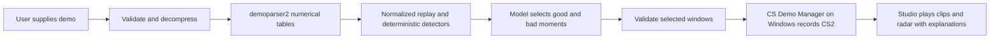

# Round Reviewer code and security review

Reviewed on 13 October 2026. This app is a useful personal prototype, but the current API is not ready for public hosting. The strongest parts are the separation of parsing, deterministic findings, model selection, and recording, plus the synthetic detector and coach tests. The largest risks are unrestricted access, unbounded work, incomplete recovery, and treating a heuristic verifier as proof that a coaching claim is true.

Your target is personal testing on a Ryzen 9 9950X, RTX 5080 with 16 GB VRAM, and 64 GB RAM, followed by a public service. Your cloud testing budget is at most EUR 30 per month. Context and memory are your responsibility; this review does not introduce either.

## Current structure

| Folder | What it does | Assessment |
|---|---|---|
| `apps/api/app/api` | FastAPI upload, processing, replay, clip, coach routes | Too much business orchestration in routes; no identity or ownership boundary |
| `apps/api/app/processing` | Zstd decompression, demoparser2, normalization, CS Demo Manager recording | Clear stages; parsing and recording need separate process boundaries |
| `apps/api/app/analysis` | Match data, round stats, ten detector modules, moment ranking | Good deterministic foundation; several signals are coaching hypotheses |
| `apps/api/app/coach` | LLM client, tool loop, MCP adapter, prompt versions, verifier, templates | Good fallback design; validation does not establish factual entailment |
| `apps/api/app/repositories` | SQLite analysis plus filesystem JSON and in-memory match records | Suitable for one process; inconsistent durability and no tenant ownership |
| `apps/api/app/rag`, `data/knowledge` | Retrieval and CS knowledge passages | Keep provenance and game/map versions; supplied memory remains outside this assignment |
| `apps/web` | Next.js upload, player selection, radar, POV clips, review and Ask | Main Studio page is 1,846 lines; replay, fetching and review state need extraction |
| `apps/mcp` | Separate coach tool entrypoint | Useful integration boundary; must enforce authorization if exposed over HTTP |
| `apps/tracker` | Development task board and optional Upstash state | Developer tooling, with a separate access problem; exclude from public product deployment |
| `eval` | Detector labeling and model comparison | Good starting point; verification rate is not a factual-accuracy metric |
| `prototype` | HTML prototype, fixtures, visual QA scripts | Reference material rather than the running product |
| `docker`, `compose.yaml` | Local API, web, optional CS:DM PostgreSQL | Local convenience configuration; public deployment needs different settings |

Git currently marks the old root `AGENTS.md`, `README.md`, `CLAUDE.md`, `docs/` and `.cursor/` guidance as deleted. These deletions were preserved. Several surviving READMEs and tracker scripts still reference those missing files. No current applicable `AGENTS.md` was found in the folder or its parent chain.

## Intended and implemented flow

The parser produces data; the model selects from detector candidates and explains them. Upload is implemented. Automated demo downloading is not currently implemented in the product pipeline. With the model disabled, the code ranker and templates provide fallbacks. The main moment recorder already uses an isolated folder per clip and a shared single recording executor, which are sound choices.

## Findings to address first

P1 means resolve before public release or before relying on the affected behavior. P2 means an important reliability or maintainability improvement. Severity describes the relevant deployment context, not an assertion that the local computer has been compromised.

### P1 Access is unrestricted

`apps/api/app/api/routes.py:71` and the match, player, replay, explanation, retry and Ask routes have no authentication or ownership checks. A second client can read a match once its ID is known and can trigger processing or inference. Random IDs do not replace access control. MCP's bound match/player arguments constrain the model inside one agent run, but the API and standalone MCP server still need to establish which user may access that match.

**Verified:** two independent unauthenticated test clients successfully uploaded and read the same match. Implement a user/session dependency and an `owner_id` or explicit sharing grant on every match operation. Scope clip access, history queries, MCP resources and tools to that authorization context. Use private caching or expiring signed clip URLs; the whole-round clip endpoint currently sets `Cache-Control: public` at line 138.

### P1 Upload and work queues allow resource exhaustion

`routes.py:76` calls `await file.read()` before checking the 300 MB limit. Concurrent oversized uploads can allocate their full bodies in RAM. Multipart spooling does not prevent this later full read. Parsing, decompression, normalization, inference and clip jobs have no per-user quotas or overall admission limit. The `ThreadPoolExecutor` at `processing/pipeline.py:66` limits active threads, but its submission queue is not a bounded queue. No retention or disk quota removes accumulated uploads and work files.

Stream uploads to disk while counting bytes, enforce an ingress limit, bound queued/active work, and reserve disk capacity before accepting a demo. Account for the permitted 2 GB decompressed size and the larger in-memory table/replay representation. Reject excess work with a clear retry response. Keep the existing magic-byte validation and decompression output cap.

### P1 The parser timeout does not stop the parser

`processing/pipeline.py:133` wraps the parser in a thread executor context. `future.result(timeout=...)` times out, but leaving that context waits for the running thread. A hung native parser can occupy a processing worker indefinitely.

**Verified:** a 20 ms deadline returned after roughly 238 ms when the parser probe slept for 200 ms. Move native parsing into a child process with an enforceable wall-clock deadline and memory budget. Terminate the child on timeout; ensure the parent API remains responsive. A process pool alone does not automatically terminate a timed-out task.

### P1 Coaching text can pass verification while contradicting its evidence

`coach/verify.py:123` checks whether numbers occur in an allowed set. At line 142, citation requirements are inferred from numbers or known zones. Neither checks whether the cited finding supports the sentence. A correct citation token can accompany a false conclusion; numbers can also be used with the wrong meaning. `autocite` cannot repair that semantic problem.

**Verified:** the verifier accepted `You won the duel through smoke [F1].` when F1 represented an untraded death. Treat `verified` as a limited citation/format check until the claim contract is stronger. Prefer structured observations with typed evidence fields, round/tick provenance and deterministic checks, followed by prose generated from those approved observations. Model-based entailment review can supplement this, but should not become a guarantee of correctness.

### P1 Halftime can produce the wrong team score and win colors

`processing/normalize.py:98` sums CT and T round winners across the match; `match.score` and `match.won` are side totals. Teams switch sides, so these are not team totals. Studio's analyzed-player overview uses `RoundStats.won`, but the header and replay timeline still consume the side-based fields.

**Verified:** one team winning as CT before a switch and as T after it produces `1–1` rather than `2–0`. Track stable team identity separately from per-round side. Support overtime and roster substitutions in that mapping; label a CT/T statistic explicitly if retained.

### P1 An old recording can be presented as a new whole-round clip

`processing/video_clips.py:361` accepts an existing output immediately. Lines 363–370 otherwise take the newest MP4 from a shared folder and move it to the requested name. If CS:DM exits successfully without producing a new file, an older round can be renamed and shown as the new result.

**Verified:** a simulated recorder that created no file moved `r1.mp4` into `r2.mp4`. The moment recorder's separate temporary folders reduce this particular risk; the whole-round path remains affected. Isolate every recording attempt, require a newly produced artifact, probe the media, validate duration and publish atomically. Never select an arbitrary previous MP4.

### P1 Patch both Next.js lockfiles

Both lockfiles resolve Next.js **15.5.26**, React **19.3.0**, and React DOM **19.3.0**. Assess the resolved versions rather than the broad minimum versions in `package.json`. The 30 September 2026 security release identifies **15.5.27** as the patched 15.5 release. Its dev-server MCP disclosure is relevant when using `next dev`; the other advisories have feature-specific conditions, several absent from these configurations. This is not a claim that all seven issues are exploitable here. [Next.js September security release](https://nextjs.org/blog/september-2026-security-release).

Update the package and lockfile together in both apps, rebuild, and run a dependency audit. Python dependencies have lower bounds but no lockfile, so a fresh installation may resolve different major versions of supporting libraries. Add a reproducible Python lock and automated advisory checks.

## Other important findings

| Priority | Evidence | Consequence and recommended change |
|---|---|---|
| P2 | `repositories/matches.py:54` hydrates only directories with `match.json` | An uploaded but unparsed match disappears from the API after restart despite its SQLite row. Confirmed by the probe. Hydrate all persisted records, retain source paths and stage state, and resume or explicitly fail interrupted jobs |
| P2 | `repositories/matches.py:104` reconstructs completion from stored analysis | An interrupted recording/explanation stage can be restored as complete. Persist per-stage jobs, attempts and results rather than inferring completion from one artifact |
| P2 | In-memory records and process-local locks/executors | Multiple API processes can disagree about matches and run simultaneous CS2 recordings. Keep one API process until durable state and cross-process job claims exist |
| P2 | `persist_replay` writes JSON directly; `repo.get` returns a mutable record | Interrupted writes and cross-thread mutations can create inconsistent state. Use atomic file replacement, manifest checksums, DB transactions and immutable snapshots |
| P2 | `video_clips.py:305`, `moment_clips.py:176` mark stub output ready | Enabling recording while leaving `csdm_mode=stub` can show a placeholder as recorded evidence. Give synthetic media a separate status/provenance and reject stub mode in public production |
| P2 | Recorder checks only file existence and nonzero size | Corrupt, truncated or wrong-duration clips can become ready. Use ffprobe and actual timing metadata |
| P2 | `request_clip` and `verify_moments` check window length but not the selected round's end | A selected or requested window can extend beyond the round. Clamp both ends, retain the original evidence window and validate the padded window before recording |
| P2 | `coach/agent.py:116` executes all returned tool calls; each chat has no job-level output cap | Six model steps can contain many tool calls and long generations. Add total calls, result bytes, output tokens, concurrency and wall-clock budgets; close or reuse HTTP clients |
| P2 | `routes.py:426` awaits inference after SSE client disconnect | Disconnected requests can continue consuming resources. Define cancellation behavior and a durable-job exception when the task was explicitly submitted to finish in the background |
| P2 | `tracker/src/app/api/state/route.ts:33` authenticates only if passcode exists | Shared storage plus an unset passcode permits public writes. GET exposes board edits even with a passcode. Require authentication for shared read/write mode; keep tracker private |
| P2 | `compose.yaml:14`, `:54`, `:58` publishes ports and uses `postgres/postgres` | Local compose exposes services beyond loopback by default. Bind local ports to `127.0.0.1`; use credentials from secrets and an internal database network for hosting |
| P2 | API Dockerfile has no non-root runtime user; health returns only `ok` | Run with minimal privileges and parser resource limits. Add worker/model readiness and queue/disk metrics without exposing secrets |
| P2 | `processing/parse_demo.py` catches all optional-event/property errors | A parser/schema regression can silently look like an empty event stream. Emit capability flags and warnings; skip affected detectors rather than treating missing data as zero |
| P2 | `dry_peek.py`, `late_rotation.py`, `untraded_death.py` use approximate proxies | A quick unsupported death is not necessarily a player-initiated peek; delayed arrival may be an intentional flank/save; straight-line distance may cross walls. Add confidence, observable-vs-inferred labels, navigation/visibility checks and human labels |
| P2 | `web/src/lib/replay/interpolate.ts:85` interpolates HP and switches alive halfway | The radar can show fabricated intermediate HP and early deaths. Interpolate continuous movement only; apply health/death events at their real ticks |
| P2 | Replay interval search is linear; Studio page owns 1,846 lines of behavior | Use binary search or a playback cursor, per-round chunks, and separate replay, review, media and query modules |
| P2 | `apps/web/eslint.config.mjs` contains only ignores | No TypeScript/React/Next rule configuration is supplied. Add the appropriate flat-config rules and an explicit ESLint command. `next lint` is deprecated in 15.5, not yet removed there. [Next.js 15.5](https://nextjs.org/blog/next-15-5) |

## Safeguards already worth keeping

- Generated server-side upload filenames, rather than writing the original user filename.
- CS2 `PBDEMS2` validation and a streaming decompression output cap.
- Parameterized SQLite queries in the examined repositories.
- Pydantic request contracts and a 500-character limit on the main Ask question.
- Bound match/player arguments and tool allowlists in coach runs.
- A ranker, multilingual templates, repair attempts and traceable prompt versions.
- A shared recording executor within one process and isolated moment-recording folders.
- React text rendering for coach output; the examined inline theme script is a fixed script, not untrusted coach HTML.

These measures reduce specific risks; they do not make the whole service secure for untrusted public users.

## Verification and limits

The existing API suite produced **229 passed, 4 skipped, 1 environment-related failure** in the broad run. The failed MCP stdio subprocess did not inherit the temporary dependency location; its stderr reports `ModuleNotFoundError: mcp`. The parent-process MCP tests passed. A separately configured retry is documented in [VALIDATION.md](VALIDATION.md).

The six synthetic audit probes in [reproduce_findings.py](reproduce_findings.py) confirmed unrestricted read/upload, lost unparsed uploads on restart, the ineffective parser deadline, stale MP4 selection, false factual claims passing verification, and the halftime score problem. These demonstrate behavior; they do not launch CS2 or claim a successful external recording.

No real `.dem` or `.dem.zst` was present, so actual parser compatibility, recording output, GPU/model performance and exact replay fidelity remain unmeasured. Frontend review was static; a production build, browser QA, npm advisory scan and penetration test were not performed. The report is an evidence-based code review, not a security certification.
