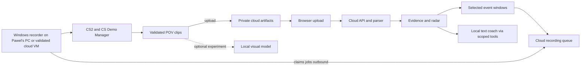

# Recording and training a grounded CS2 coach

Planning recommendation, 19 October 2026. This extends the [final delivery plan](FINAL-DELIVERY-PLAN.md); its RR task IDs remain authoritative. It does not claim that training, recording or dataset validation has already run.

## 1 Recommended approach

Build a telemetry-first coach: code extracts match evidence; the model requests relevant evidence through tools, retrieves reviewed CS2 knowledge and produces an explanation with citations. Render short POV clips for the user and human labellers. Test a vision-language model separately only if the core delivery is secure.

Fine-tuning should teach the model how to investigate and explain a CS2 situation, including when the evidence is insufficient. It should not be expected to discover sound coaching simply from millions of ticks or professional gameplay. A small reviewed dataset can test whether these behaviours improve; it cannot establish general expert-level coaching.

Keep these responsibilities separate:

| Layer | What it supplies | What it cannot establish alone |
|---|---|---|
| Parser and deterministic analysis | Events, timing, economy, equipment, positions and other actually available fields | Whether a decision was sensible or what a player knew |
| Reviewed knowledge retrieval | Map callouts, mechanics and conditional tactical principles | What happened in this particular match |
| Text model and tools | Evidence selection, contextual explanation, EN/PL answers and uncertainty | Missing line of sight, communications, intent or exact visual perception |
| Rendered POV and optional visual model | Additional visual context around a particular event | Perfect reconstruction of the player's experience or proof of the best decision |
| Human annotation | Evidence-grounded assessment, acceptable alternatives and disagreement | An infallible tactical oracle |

Do not penalise a player using hidden enemy positions that are visible only in spectator data. Record known information, unknown information and hindsight separately. A won fight can follow a poor decision; a sound decision can lose. Missing communications remain missing even if a model invents a plausible story.

## 2 Recording architecture



The cloud instance runs the API and parsing. It does not need Steam, CS2 or a GPU. The recorder can run on Pawel's existing Windows machine or a separately validated Azure/Google Windows GPU VM; Aleksander requests and watches clips through the same application. A reliable unattended session is a preflight requirement, not something to assume from a successful manual recording. Visitors never supply Steam credentials.

Reuse the existing per-moment recording path in `apps/api/app/processing/moment_clips.py`. It already creates bounded windows and uses the video worker. Adapt this path to the outbound job contract rather than adding a separate training recorder. CS Demo Manager supports tick-defined sequences and focused player views; its Windows HLAE + FFmpeg path can avoid intermediate raw frames. Game updates can break recording compatibility, so record the tested versions. [CS Demo Manager video guide](https://cs-demo-manager.com/docs/guides/video)

Pawel implements and validates this sequence under RR03/RR20:

1. Start with one real demo per supported map. Manually render a known event, then repeat through the existing worker. Check the Windows session, Steam/game availability, CS:DM analysis state, seek and player focus before automating remote jobs.
2. Cloud analysis produces a typed request: owner, demo hash, match, player, round, start/end ticks, event anchor, capture profile and attempt ID. The worker downloads only its authorised input and validates the request. No free-form commands come from the model.
3. Begin with approximately 10–25 seconds per useful moment. Choose context before the decision and enough aftermath to understand it; extend toward 30–45 seconds when necessary within existing bounds. This is a proposed profile to measure, not a fixed definition of a tactical event.
4. Use a consistent first-person profile with x-ray disabled and documented HUD/radar/audio settings. Begin the hosting feasibility check at 720p/30 fps, matching the current configuration default; compare 720p/60 fps for human review if measured quality justifies the cost. Keep the original encoded clip; optional model frames are derived separately. Never use sparse frames to claim millisecond reaction accuracy.
5. Validate nonempty, decodable media, expected player, tick/time mapping and event alignment. Save checksums and provenance. Reuse the final plan's measured alignment gate. Publish only after validation, and show recording errors as errors rather than attaching an older clip.
6. Upload the private artifact and complete the lease. Restart, retry and cancellation must not mix attempts or kill unrelated user processes. Reuse a clip only when demo, player, window and capture-profile hashes match.
7. Measure queue wait, download, game startup/seek, capture, encode, upload, disk and GPU usage separately. Six 20-second clips total two minutes of output; that is not a promise of two minutes of processing.

One expensive GPU job runs at a time initially. Reserve recording batches and training windows with Aleksander. During training, model-dependent live requests can wait with a truthful state; cloud parsing and radar remain usable. Keep the known-good defence clips and inference configuration separate from experiments.

For annotation, inspect the full round through radar and request additional clips when necessary. Reviewing only the model's selected highlights would hide missed events and bias the labels. Rendered demo POV is a reconstruction: do not describe it as a recording of exactly what the player saw, heard or intended.

### 2.1 Both visual feedback paths — research and proposed integration, 20 October

The user requests both paths in the plan: recorded clips and a minimal Three.js tactical replay with player locators, look direction and weapon/action indicators. They share the same selected moment and time model. Three.js is a useful addition and the proposed visual fallback if recording fails; it does not require a Windows recorder. No deployment, new renderer or remote-worker API has been implemented during this research.

| Path | Processing and delivery | Benefit and gate |
|---|---|---|
| Recorded clip | Windows worker downloads the authorised demo, runs CS2/CS:DM, uploads an MP4, and reports its manifest to the main API. Browser plays the stored video. | Engine-rendered context; gate is real capture reliability, correct player/time and operating cost. |
| Three.js tactical replay | Cloud parser produces bounded state/event data; browser loads a verified map asset and draws simple player markers, headings and weapon indicators at the shared playback time. | Interactive positioning feedback without game rendering on a VM; gate is map calibration, state/event correctness and browser performance. |
| Existing 2D radar | Existing parsed replay with validated shared-clock behaviour. | Remains available if either video generation or 3D loading fails. |

Azure NVadsA10v5 offers graphics VMs with GRID licensing. Google documents a Windows GPU workstation on Compute Engine with qualified vWS drivers. These are candidate hosts, not demonstrated CS2 recording installations. Vertex AI is for the model workload, not this Windows graphics worker. Use the [hosting research and bounded test](HOSTING-AND-GPU-PLAN.md#azure--google-recording-feasibility--research-20-october-2026) before choosing or spending.

Three.js has a glTF loader; Source 2 Viewer documents map export to glTF/GLB. A ready-made community asset can replace the export step only after checking its provenance, map revision, usable format, redistribution terms, scale and size. No particular third-party map download has been validated here. Start with Mirage and ten generic markers; add pitch, active weapon and shot events as described in the [minimal fallback plan](HOSTING-AND-GPU-PLAN.md#minimal-tactical-fallback-implementation). [Three.js loader](https://threejs.org/docs/pages/GLTFLoader.html), [map export](https://s2v.app/ValveResourceFormat/guides/exporting-maps.html).

### 2.2 One public API, outbound workers and private object storage

**Recommendation: keep one application API. Do not add a second public HTTP API on the Windows recorder.** Run a worker process there which makes authenticated outbound HTTPS requests to the existing FastAPI service. The worker can live on Azure, Google or Pawel's PC without changing the browser's API.

Use a durable database job table initially. The API atomically leases a job to a worker; a lease means a time-limited claim, renewed by heartbeat. No shared Windows/Linux filesystem or direct worker database connection is needed. A message broker can be introduced later if measured scale requires it.

```mermaid
sequenceDiagram
    participant U as Browser Studio
    participant A as Main API and job database
    participant P as Cloud parser and analysis
    participant L as Model worker
    participant W as Windows recorder
    participant S as Private object storage
    U->>A: Upload demo and select player
    A->>P: Queue parse and evidence extraction
    P->>A: Replay data, findings and tick references
    L->>A: Claim selection job and retrieve scoped evidence
    L->>A: Return selected evidence IDs and proposed windows
    A->>A: Validate, pad and clamp windows; queue recordings
    U->>A: Poll review and moment status
    A-->>U: Evidence and tactical replay available
    W->>A: Claim recording job
    A-->>W: Lease, capture specification and demo download grant
    W->>S: Download authorised demo
    W->>W: Analyse in CS:DM, record and validate MP4
    W->>A: Request upload grant for current attempt
    A-->>W: Scoped upload destination
    W->>S: Upload MP4
    W->>A: Complete attempt with artifact manifest
    A->>S: Verify expected object and validation evidence
    A->>A: Publish clip metadata atomically
    U->>A: Poll status and request authorised playback URL
    A-->>U: Ready clip and temporary read URL
    U->>S: Play and seek MP4
```

The original demo remains in private storage according to retention policy. The recorder returns a new **MP4 artifact plus metadata**, not another copy of the demo. The model does not transfer video and the recorder never needs the visitor's browser address. Stored clips remain playable after the recorder stops. Closing/reopening the browser does not cancel durable work unless the user explicitly cancels it.

Storage choices are Azure Blob Storage or Google Cloud Storage. Prefer API, storage and recorder in one provider/region where practical to simplify transfers and billing, but HTTPS permits mixed providers. Store object identifiers in the database, not permanent signed links.

Azure supports SAS grants scoped by resource, permission and expiry; prefer user-delegation SAS where available. Google supports time-limited signed URLs, including upload/download workflows. For larger transfers, its resumable upload session can be initiated by the server and handed to the worker. These grants are bearer credentials: do not log or expose worker upload grants to the browser. [Azure user-delegation SAS](https://learn.microsoft.com/en-us/azure/storage/blobs/storage-blob-user-delegation-sas-create-python), [Google signed URLs and resumable uploads](https://docs.cloud.google.com/storage/docs/access-control/signed-urls).

For an initial transfer smoke test, the worker may POST a bounded MP4 directly to the main API instead. That still requires no second API, but ties bandwidth, disk and request limits to the API host. Direct upload to private object storage is the recommended deployed path.

### 2.3 From a coaching observation to an exact recording window

The LLM chooses supported findings and useful context; deterministic backend code resolves the final time range. Do not allow generated shell commands, arbitrary paths, invented frame numbers or unconstrained intervals.

Example, with illustrative values:

- Finding covers round-relative elapsed **42–46 seconds**, anchored to a real event.
- A proposed context policy adds **5 seconds before and 3 seconds after**: record **37–49 seconds**, subject to round bounds and the maximum clip duration.
- If the validated round origin is tick **64000**, and the demo timebase is **64 ticks/second**, record ticks **66368–67136**. The event at 42 seconds maps to tick **66688**.
- With no capture offset, that event appears **5 seconds into the clip**. Save and validate any actual capture offset instead of assuming the exported video starts at precisely the requested tick.

Use the parser's canonical absolute ticks and declared origin. Round elapsed time is not the game's countdown clock; pause/freeze-time semantics must match the shared replay contract. Convert seconds with that timebase and explicit rounding/boundary rules, not the output video's FPS. A 30 fps video and 64 tick/s demo use different units.

Keep `eventStartTick/eventEndTick`, `captureStartTick/captureEndTick` and the actual video-to-demo mapping separate. The former highlights the decision; the latter includes context. Three.js and radar open the same padded interval and highlight the same event.

Current configuration pads by **1 second before / 3 seconds after** and `moment_window()` caps clips at 60 seconds; the 5/3 example above is a proposed starting policy to evaluate, not the currently implemented default. Clamp both ends to the valid round and reject impossible windows, including at end-of-round. Larger tactical sequences may need different bounded context. Avoid double-padding an already padded selection.

CS:DM supports tick-range video commands and player focus, and requires the demo to be analysed in its own database first. Analyse/cache once per demo content hash and compatible tool/game version rather than unnecessarily repeating it for every moment. Pass validated arguments through the existing recorder adapter. [CS:DM CLI](https://cs-demo-manager.com/docs/cli).

### 2.4 Proposed API contract — not existing endpoints

All worker routes below live in the **same main API**, behind worker authentication. Names are proposed contracts; implement through RR05/RR09/RR20 and keep browser contracts compatible where possible.

| Route | Purpose |
|---|---|
| `POST /internal/recording-jobs/claim` | Atomically claim one compatible job; return job/attempt IDs, lease token/expiry and capture specification, or no work. |
| `POST /internal/recording-jobs/{id}/heartbeat` | Renew the current lease and report a truthful stage; return cancellation intent where applicable. |
| `POST /internal/recording-jobs/{id}/input-access` | Issue/refresh a short-lived download grant for the job's exact demo. |
| `POST /internal/recording-jobs/{id}/upload-access` | Issue a narrowly scoped grant for a server-selected, unique attempt object. |
| `POST /internal/recording-jobs/{id}/complete` | Submit artifact metadata for validation; publication follows validation, not merely this request. |
| `POST /internal/recording-jobs/{id}/fail` | Record failure reason and release/retry according to policy. |
| Existing `GET /matches/{match}/players/{player}/clips` | Return persisted clip statuses. Remove the current side effect that starts a local recorder. |
| Existing clip `.mp4` route, or a new playback-grant route | Authorise viewer access and redirect to/return a fresh read grant, or proxy bytes when immediate revocation is required. |

A recording specification contains schema version, job/attempt IDs, scoped match/player/round IDs, demo artifact/hash, selection version, finding/moment references, tick bounds, timebase, capture profile and lease. The worker has no authority to change the owner or substitute another demo/window. Storage destinations are chosen by the API, never arbitrary worker-provided URLs.

Completion metadata contains object ID/version, byte length, SHA-256, codec/resolution/FPS/duration, requested and observed tick mapping, capture profile and CS2/CS:DM/HLAE versions. A checksum detects transfer changes; it does not prove that the camera or event is correct. Run bounded media probing/decoding and timing checks before publication; establish semantic correctness through known demo fixtures and human checks. A tiny placeholder MP4 must never pass as a real clip.

Suggested persisted attempt stages: `queued -> leased -> downloading -> recording -> uploading -> validating -> ready`, with `failed`, `cancelled` and bounded retries. Map these explicitly to existing browser status types when migrating. Start with one recording per machine. Heartbeats continue during slow capture, not only between commands.

Use atomic database claims and conditional completion against the current lease/attempt. Duplicate completion is idempotent; an expired worker cannot publish over a newer attempt. If upload succeeds but completion is interrupted, retry completion without re-recording. A writable upload grant must not allow a ready object to change: publish a verified immutable object version or copy it to a final object to which the worker has no write grant. Clean up abandoned temporary objects.

A cache key includes demo hash, player, exact ticks, profile and compatible game/recorder versions. Bind artifacts to authorised reviews even if content is deduplicated. Retention/deletion must invalidate pending jobs and prevent late completion from resurrecting a deleted review.

### 2.5 How the Studio receives and plays the feedback

Poll persisted statuses every few seconds initially; add server-sent events only if later useful. Progress must survive page reloads and have a status-read fallback. The browser never waits on a single HTTP request for CS2 to finish.

Show one moment with its explanation and available views: **Radar**, **3D tactical**, and **Recorded clip**. Each has independent availability. If recording fails, keep the moment and tactical view usable, show the actual failure state and allow an authorised retry. Do not silently switch views or autoplay a late clip while the user is inspecting something else.

The API checks the user's right to the review before returning a temporary read URL. A native video element can use that URL without a separate recorder login. Use an expiry sufficient for normal playback and renew through the API when needed, preserving playback position. Signed links remain usable by their holder until expiry; if immediate revocation is required, serve through an authorising proxy instead.

Use browser-compatible MP4, initially H.264 video/AAC audio where audio is present, and fast-start metadata placement. Verify byte-range seeking, content type and the storage endpoint/CORS configuration used by the actual browser. Avoid loading entire MP4s as base64 JSON or routing video bytes through chat/WebSockets. HLS/CDN infrastructure is unnecessary for the initial short-clip test. [FFmpeg MP4 faststart](https://ffmpeg.org/ffmpeg-formats.html), [HTTP range requests](https://developer.mozilla.org/en-US/docs/Web/HTTP/Guides/Range_requests), [Google Storage CORS](https://docs.cloud.google.com/storage/docs/cross-origin).

### 2.6 Existing code, gaps and assigned implementation order

Inspected on 20 October; this is source inspection, not an end-to-end runtime pass:

| Existing foundation | Integration required |
|---|---|
| `processing/moment_clips.py`: selected moments, configurable padding, clip jobs, tick conversion, local recorder | Extract the capture adapter into an outbound worker, use authoritative bounded ticks, leases and attempt-specific work/output. |
| `repositories/analysis.py`: SQL-backed clip rows | Add transactional remote claims, heartbeat expiry, attempt/version identity, artifact metadata and conditional publication. Existing rows are not a distributed lease protocol. |
| `processing/video_clips.py`: CS:DM subprocess/capture helpers | Validate real media, remove false-ready stub behaviour, handle cancellation/recovery and browser capture profiles. Reconcile the preserved Phase 1 patches. |
| `processing/pipeline.py`: synchronous `record_now()` stage | Queue recording independently so telemetry-based explanations and replay do not wait for all clips. |
| `api/routes.py`: clip list/retry and local `FileResponse` delivery | Remove recorder side effects from GET, decouple recorder availability from the API host's CS:DM setting, authorise storage grants and preserve existing client URLs where practical. |
| Replay samples and shared playback clock | Add typed pitch/weapon/event data for the minimal Three.js view; map asset/calibration and browser rendering remain new work. |

Implementation order, expanding the existing RR backlog:

1. **Pawel — RR05/RR09:** define and persist the shared moment/time/artifact/lease contract. **Aleksander — RR14/RR17:** constrain model selections to authorised evidence IDs/windows, validate usefulness and keep explanations independent of clip completion.
2. **Pawel — RR20/RR21:** prove the return path with an explicitly labelled test worker uploading an existing known-good MP4. Verify owner checks, object validation, browser seeking, reloads and playback after the worker stops. This proves transport only, not CS2 capture.
3. **Pawel — RR03/RR20:** connect real local CS:DM capture through the same contract; then run the bounded Azure or Google VM test. Do not build different recorder APIs for each provider.
4. **Pawel, with Aleksander checking evidence:** prove one real round on one calibrated 3D map, then weapons/actions; expand to all three maps after the first gate. Coordinate this fallback scope within RR19/RR20 rather than silently adding an unestimated full renderer.
5. **Both — RR22:** test worker crash, expired lease/read grant, duplicate completion, partially uploaded media, cancellation/deletion, wrong-owner access, recording unavailable, 3D asset unavailable and both users viewing their own reviews concurrently.

Keep app API/parser online independently of the expensive VM. A worker cannot poll while its VM is deallocated: the initial experiment uses manually scheduled operating hours. Automatic VM wake/idle shutdown would be a later control-plane task with restricted cloud permissions, not another public recording API. Budget and deadline decisions remain in the delivery/hosting plans.

## 3 What to label yourselves

Use your own and invited players' permitted demos as the core corpus because these represent the users you intend to coach. Separate permission to process a demo from permission to reuse it for research/training. Keep identifiable data and clips in controlled storage; use pseudonymous references in training exports.

Retain the agreed 100-match target and 65/15/20 match split. Allocate the 150 annotated rounds as a proposed 90 train / 30 validation / 30 test distribution, with map and situation coverage in each. RR02 freezes the exact allocation before development begins. The 300 training conversations are derived only from training matches; they are not 300 independent matches or 300 independently observed situations.

Start with 30 training rounds, ten per map, independently labelled by both students. These are the agreed overlap labels, not an extra 30-round commitment. Compare labels, refine the rubric and retain original judgements alongside adjudication. Divide the remaining 120 rounds equally, giving each student 90 round reviews overall. Record review time in the pilot and adjust the schedule before scaling. Keep test annotations inaccessible to prompt/detector tuning.

Extend the existing `eval/label_tool.py` and `data/labels` format rather than building a new annotation application. Existing correct/wrong/unsure finding labels and missed-event entries remain useful, but they need the following coaching fields:

| Field | Labeller records |
|---|---|
| Identity and evidence | Match/split, map, player, round, event window, evidence IDs and optional clip/frame timestamps |
| Observed facts | What can be checked directly; whether a detector is correct, wrong or uncertain |
| Decision context | Economy, objective, time, teammates and information actually available; explicit missing context |
| Assessment | Helpful play, mistake, neutral or uncertain; decision quality separately from outcome |
| Explanation | Why the assessment follows from the evidence and assumptions; avoid claims about intent |
| Actionable alternative | One feasible next action or habit, with acceptable alternatives where tactics are ambiguous |
| Priority | Learning relevance/severity, confidence and whether this deserves a selected moment |
| Review | Independent labeller, disagreement, final review status and rubric version |

Include good plays, mundane rounds, false detector alarms and insufficient-evidence cases, not just deaths or dramatic mistakes. When a question cannot be answered, a correct target can be a qualified answer or a request for more context. Do not force every round into good/bad.

Illustrative annotation, not a claim about an inspected demo: “No teammate traded this death within the measured interval” can be supported by events. “Your teammate was close enough to trade” also needs timing, geometry and visibility; distance alone is insufficient. The advice should preserve that distinction.

Human review is the main quality bottleneck. Ideally ask an experienced player to review a small disputed subset during the invited study. Treat this as additional evidence, not a dependency or an implied promise of expert-labelled data. If only the two authors label, state that limitation. Report disagreement and unsure rates; do not quietly discard uncertainty from the study narrative.

## 4 Public datasets: useful inputs, not ready-made coaching answers

I found aligned CS2 gameplay datasets, but the sources checked do not supply ready-to-use human-validated answers to your full coaching task. Event labels such as a kill, movement action or round outcome are different from labels saying whether a decision was good and why.

| Source | Evidence and recommended role |
|---|---|
| [OpenCS2](https://huggingface.co/datasets/blanchon/opencs2_dataset) | Provides POV video with tick-aligned state/action data and event indices. Useful for a small visual/data-alignment experiment or additional human annotation. Its card lists renders/metadata as CC-BY-4.0 and says source demos remain subject to original tournament terms. Inspect metadata first and retrieve selected clips only. Do not bulk-download the corpus or assume automatic event labels are coaching truth. |
| [CounterStrike-1K](https://huggingface.co/datasets/ArnieRamesh/CounterStrike-1K/blob/main/README.md) | Provides synchronised professional POV/state data for world-model research. The card specifies noncommercial licensing and lists player profiling/ranking among out-of-scope uses. Keep it as a research reference; do not adopt it for personalised coaching training without resolving the stated use restrictions. |
| Your permitted matches | Primary source for the December experiment: known provenance, target-user relevance and labels built against your actual parser/tools. Retain independent validation/test matches. |
| Reviewed CS2 guides | Use supported extracts or original summaries in the knowledge base with source references; keep current tactical knowledge retrievable rather than trying to encode every map detail in model weights. |

Professional play can depend on team coordination unavailable in amateur matches. “Imitate a professional action” is therefore not automatically the right coaching target. Public data supplements your corpus; it does not remove human judgement or domain-shift evaluation.

Record source URL/version, permitted use, attribution and demo identity for every imported item. Keep translations, different POVs, clips, event variants and duplicate public copies of the same match in one split. A cross-match example may use only source matches from its assigned split; otherwise reject it. Split by match before creating examples.

## 5 Training data and code gaps to fix first

Teach a complete evidence-seeking interaction: user question -> appropriate tool call -> actual tool result -> optional knowledge retrieval -> concise grounded response. Training only polished answers would miss tool selection, argument correctness and interpretation of returned data. Use concise explanations, not invented hidden reasoning transcripts.

The inspected Studio `apps/api/app/services/dataset.py` is a useful starting point but is not ready for this experiment:

- It assigns an 80/10/10 hash split. Replace this with the frozen match manifest; reject missing or mixed-split provenance, including cross-match history.
- It exports `messages` but not the available tool schemas. Capture versioned schemas with traces and export them with each conversation.
- Its job allowlist does not include moment selection. Add reviewed selection trajectories if selection is a training objective. Keep deferred practice-plan features out of this December dataset.
- Its editor checks new citations/numbers against the original response/prompt. A correct human replacement needs validation against the actual tool evidence and knowledge passages, including correcting the original answer's citations.
- Passing citation/number checks is not semantic validation. Human reviewers must check tool arguments, interpretations, language and usefulness, not just accept model output that passed the verifier.
- Repaired traces can contain wrong assistant targets. Keep them excluded unless rebuilt as a clean, human-verified trajectory with real tool results. Preserve the rejected original in the audit record.

Aleksander leads this under RR24, with Pawel supporting trace/tool contracts under RR05/RR15. Export metadata should include all source match IDs, split, language, task, evidence/source versions, reviewer, model/prompt configuration and content hashes. Training never learns a fabricated tool result as fact.

Suggested allocation for the 300 accepted training conversations:

| Primary task | Target | Training signal |
|---|---:|---|
| Evidence-seeking questions | 100 | Correct tool choice/arguments, grounded answer and citations |
| Moment explanations | 100 | Good and poor decisions, useful alternatives and uncertainty |
| Moment selection | 60 | Supported ranking across multiple rounds without forced positives |
| Insufficient or misleading evidence | 40 | Abstention, correction of false premises and qualified advice |

Aim for balanced EN/PL coverage within each category. Review translations manually. A translated pair counts as two conversations but one underlying situation; report both counts. These are sampling targets to refine in RR02, not reasons to invent poor-quality examples to fill a quota. Both students review their allocated half; cross-review an initial subset and every disputed example.

For tool-use SFT, TRL expects conversation messages containing calls/results plus a `tools` schema column. Use the model's compatible chat template and check assistant-only training masks on a tokenised example, including tool-call targets; system/user/tool-result tokens should not become prediction targets. [TRL SFT documentation](https://huggingface.co/docs/trl/sft_trainer)

## 6 Fine-tuning experiment on the RTX 5080

Aleksander leads RR04/RR25/RR26/RR32. Treat these as bounded experiments with saved configurations:

1. **Establish the baseline first.** Compare deterministic templates and the existing text model with tools/RAG on validation situations. Inspect actual errors to decide which behaviours need training. Better evidence or retrieval can solve errors that fine-tuning cannot.
2. **Run a training smoke test early.** Use a small reviewed training subset, check CUDA/software compatibility, loss masks, memory and saved-adapter reload before curating all 300 examples. Preparation starts before the defence; do not replace the defence build.
3. **Start with a smaller checkpoint if necessary.** Try a 4B-class text model for the local pilot, then consider 8B/14B only after measurement. Inference of a quantised 14B model does not establish that training it fits. Use the original compatible training checkpoint with quantised loading, not the deployed GGUF file as training input.
4. **Use QLoRA.** PEFT documents four-bit loading and training adapters over a frozen quantised base. NF4 and double quantisation are supported options. [PEFT quantisation guide](https://huggingface.co/docs/peft/developer_guides/quantization)
5. **Measure a conservative configuration.** Suggested initial experiment: batch size 1, gradient accumulation/checkpointing, short complete trajectories around 1,024–2,048 tokens and small adapter rank. These are starting hypotheses, not verified hardware settings. Shorten tool output before truncating; never cut a call away from its result or answer. Record rejected overlong examples and test longer real requests separately.
6. **Choose on validation performance.** Bound the number of experiments and epochs in RR02, retain seeds/checkpoints and stop if overfitting or factual regressions appear. Falling training loss alone is not success. Keep tools, retrieval and decoding comparable between the base and tuned model.
7. **Verify the deployed variant.** Save adapter/tokenizer/template/config and reload them. Confirm the chosen model's export/serving path before spending on a full run. If conversion/quantisation is used, rerun tool/answer fixtures after it and evaluate that served artifact. Report export failure rather than treating a training checkpoint as a finished integration.
8. **Use larger rented/university hardware only if needed.** Prepare data and commands locally first. The optional GPU experiment remains within the $30 target unless separately agreed. Never rent solely because the first configuration ran out of memory.

When the pilot uses a smaller model, compare its base and tuned versions to isolate fine-tuning's effect. Report the original 14B baseline separately; comparing a tuned 4B model only against a base 14B model would confound model size with training.

The 20 November milestone is a measured training outcome, not a promise that fine-tuning wins. Prefer the base model for the product if the adapter hurts factuality or useful tool behaviour. The report still includes the documented experiment and its limitations.

## 7 Optional short-video experiment

Video analysis requires a vision-language model; the current text-only coach cannot consume frames directly. A small existing model such as [Qwen3-VL-4B-Instruct](https://huggingface.co/Qwen/Qwen3-VL-4B-Instruct) is a candidate for image/video input, not a verified CS2 specialist or a guaranteed memory fit. Do not add vision fine-tuning to the December commitments.

Use OPT03 only after the next P0 gate is secure. Cap the first investigation at two working sessions. Select 30 development clips, ten per map, with visual questions that telemetry cannot directly settle: apparent obstruction, exposed positions or coarse crosshair placement. Include ambiguous clips and blinded human answers. Start with a bounded short sequence or 8–16 timestamped frames; document sampling and what it can miss.

Compare telemetry/tools/RAG alone against the same context plus visual observations. Record correct observations, unsupported claims, usefulness, latency and peak VRAM. This pilot is exploratory and does not use the final test set. If results justify further work, define a separate untouched validation sample and acceptance criterion before testing it; otherwise defer integration.

If integrated later, expose a scoped clip/frame tool and preserve visual timestamps, model version and uncertainty. A visual model's description is an additional fallible observation, not a replacement for parsed event facts. Disagreement should trigger a qualification or human inspection. Do not infer precise reaction time, invisible communications or intent from sampled frames. Keep per-frame identifiers distinct from deterministic evidence IDs so citations do not imply equal reliability.

## 8 Assigned work and handoffs

These expand existing rows rather than create a competing backlog.

| Task and target | Pawel | Aleksander | Completion evidence |
|---|---|---|---|
| RR02/RR03/RR04, 22 Oct | Three-map recording/parser preflight; measure costs and resources | Rubric/split protocol, baseline tools/RAG and training environment preflight | Measured samples, fixed protocol, known blockers |
| RR05, 23 Oct | Define clip/tick/evidence/trace contracts | Define training provenance and tool-schema requirements | Shared fixtures and versioned fields |
| RR12, 6 Nov | Label overlap and half the remaining rounds | Lead corpus, label overlap and other half, preserve disagreements | 150 unique rounds, 30 overlap, sealed test material |
| RR20, 11 Nov | Outbound recorder, private upload, clip manifest and alignment | Check clips support annotation and expected evidence | Real aligned clips on all maps; recovery evidence |
| RR24, 14 Nov | Support evidence/schema exporter fixes; review allocated examples | Lead exporter correction and 300 accepted conversations | Manifest-controlled export; valid tools; no held-out leakage |
| RR25, 20 Nov | Reserve GPU windows; retain defence build | QLoRA, reload/export and validation comparisons | Reproducible result, including failure if applicable |
| OPT03, before 24 Nov only if P0 secure | Supply existing clips | Lead bounded visual-model probe | Measured value/cost decision; default defer product integration |
| RR32, 28 Nov | Blind ratings and reproducibility review | Frozen held-out comparisons and error analysis | Base versus tuned at same size; raw metrics and uncertainty |

By the first defence, show a real telemetry-grounded explanation and its clip, plus the labelling/training method and interim baseline measurements. By 6 December, deliver the working invited-user product and honest evidence about whether fine-tuning improved it. Full-match visual analysis and training a game-playing/world model are outside this plan.

Only planning documents were changed for this work. No dataset was downloaded, model trained, recorder launched or cloud service provisioned.
