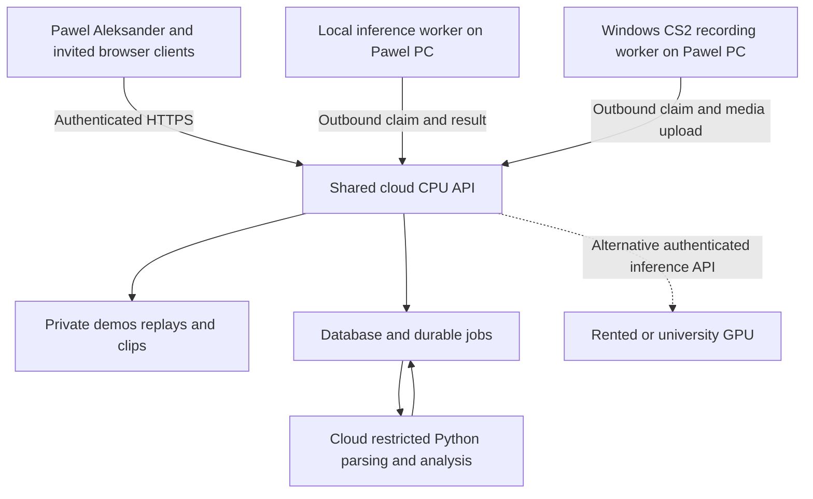

# Round Reviewer hosting and GPU experiment plan

Final architecture reference, 19 October 2026. Read with the authoritative [delivery plan and assigned backlog](FINAL-DELIVERY-PLAN.md). Invited-user access is required by 6 December; public access comes later. Pawel confirms the RTX 5080 PC is available and can remain online for testing. No infrastructure has been provisioned, no accounts changed and no money spent.

## Recommended deployment

The API and upload/parsing pipeline are required on a real shared cloud instance early, so Pawel and Aleksander can access the same backend concurrently. Local runs establish development baselines only. Keep Python parsing on the cloud CPU host; inference and Windows recording stay on Pawel's RTX 5080 PC. Frontend hosting is independent: the browser client can use this API without its own backend or a separate frontend hosting service.

The worker arrows show connection initiation. Jobs still flow from the hosted queue to the worker as responses to authenticated requests. The home PC needs no public inbound model or recorder port for this design. Keep the initial implementation to a polling worker and database-backed claims; do not add a message broker unless measurements justify it.

| Stage | What runs where | User experience |
|---|---|---|
| Development baseline | Local test setup only | Measure resources and regression behaviour before deployment |
| Shared cloud proof, before defence | Cloud API/parser/metadata/artifacts; model and Windows recorder on Pawel's PC | Both students access the same backend from separate devices; no local parsing dependency |
| Invited friends | Same hardened cloud backend; lightweight browser Studio; local workers connect outbound | Upload in browser, immediate job status, radar/facts first, explanation and clips as ready |
| Public website, after submission | Reassess topology, capacity and operating budget after invited testing | No public registration or unrestricted processing commitment for 6 December |
| Independent hosting later | Move inference to university/rented GPU; move recording only after a separate feasibility test | Removes selected home-PC dependencies; each move has its own cost and validation |

Pawel will keep the RTX 5080 PC online for testing. RR37 deploys the cloud foundation by 24 October and RR08 proves cloud parsing by 29 October. RR21 hardens that deployment; RR22 tests outages. Uploads, parsing and numerical replay must continue when GPU workers are offline. Concurrent sessions do not require unbounded parallel parsing: queue CPU/GPU jobs within measured limits while keeping the API responsive. Public capacity is assessed after submission.

## What requires Windows and Steam

CS Demo Manager actually starts the game to render a clip. Its documentation supports CS2 recording on Windows and Linux; HLAE is specifically Windows-only. Preserve the current Windows/HLAE route for the project because it matches the existing implementation. Linux recording is a possible separate experiment, not a drop-in replacement. [Video documentation](https://cs-demo-manager.com/docs/guides/video)

The CLI supports selected tick ranges, player focus and config-file recording, and expects the demo to have been analysed into its database. This fits a queued recording adapter. [CLI documentation](https://cs-demo-manager.com/docs/cli)

Worker setup: Pawel's RTX 5080 Windows machine, functioning graphics session/driver, Steam/CS2, CS:DM and its database, HLAE and FFmpeg/ffprobe. RR03/RR20 verify actual login/session behaviour, display requirements, locks, restarts and reconnects. Do not assume a headless service or locked remote session behaves like an interactive desktop.

Steam authentication remains on the operator's machine. Website users upload demos, not Steam credentials. CS:DM database setup is a recorder implementation detail; it does not force a matching database choice for the application.

A cloud GPU sold for AI inference is not automatically a usable Windows game-recording host. Only consider moving the recorder after verifying the OS/image, graphics/session support, game installation/login, available disk, capture output and idle billing. This is outside the $30 inference experiment.

## Worker protocol and acceptance checks

Each job carries a generated job ID, authorised artifact ID, match/player scope, stage, versioned input, lease expiry and attempt number. Recording jobs add validated start/end ticks and an allowed capture profile. Resolve fixed executables and file destinations on the worker; jobs never carry arbitrary shell commands or filesystem paths.

1. Worker authenticates with a revocable credential and claims one allowed job.
2. API grants a bounded lease and access only to that job's inputs.
3. Worker validates input hashes, reports a heartbeat and writes to a fresh attempt directory.
4. On success, worker uploads results; API validates the manifest and publishes atomically.
5. Retry or expired leases must not publish duplicate/stale results. Cancellation stops only owned work.
6. API restart and worker disconnect leave recoverable job states. Test deliberately with the network disabled and each process restarted.

Start with one GPU task at a time across inference and recording. Measure model memory residency and CS2 contention; unloading/reloading the model may be needed. If model inference moves to another GPU, this restriction can be revised using measured evidence.

The recording gate includes correct player, tick window, media readability and event alignment. A valid MP4 alone is not sufficient. The remote acceptance gate also tests user isolation, private media, upload limits, storage cleanup and worker credential revocation.

## Local model and cloud API options

Use the existing model client behind a configuration boundary. The Studio talks only to your API; provider credentials stay on the backend. Never silently replace local inference during a research run. Store model identity, weights/quantisation, prompt, serving configuration, hardware, timings and fallback reason.

| Option | Use | Research interpretation |
|---|---|---|
| Local llama.cpp on Pawel's GPU | Primary baseline and initial product | Direct evidence for the consumer-hardware viability question |
| Your chosen model deployed on a rented GPU | Controlled comparison or temporary inference capacity | Self-managed model on rented hardware; repeat the same workload first |
| University GPU | Alternative hosting/training capacity | Record its hardware and configuration separately; check availability and software permissions |
| Provider's managed model endpoint | Possible separately labelled API fallback/comparison | Not evidence of running the model yourselves; exact weights, tuning and feature parity may differ |

SimplePod publishes an OpenAI-compatible managed inference endpoint as well as compute-rental APIs. These are different products: rental can let you serve your chosen model; a managed endpoint serves the provider's offered model. Confirm tool calling, structured output, streaming, model/version and adapter support before choosing either. [SimplePod API documentation](https://api.simplepod.ai/docs_ai.html)

## A $30 total experiment

Treat $30 as an experiment target. Suggested envelope: $5 setup/smoke, $17 measured runs, $8 storage/tax/other charges and contingency. Do not treat the reserve as guaranteed to cover every fee, and do not buy an always-on service from this budget.

Runpod's public list checked 19 October 2026 shows RTX A6000 48 GB at $0.59/hour, RTX 4090 24 GB at $0.89/hour and RTX Pro 6000 96 GB at $2.49/hour. These are displayed rates, not a reservation or guaranteed checkout quote. As an illustration, eight compute hours on A6000 plus eight on 4090 totals $11.84 before additional charges. Availability and final price must be rechecked. [Runpod pricing](https://www.runpod.io/pricing)

Recommendation: test locally first; then pick one rental based on measured needs. A 48 GB candidate is worth considering when memory blocks the experiment; a 24 GB candidate may suffice for inference. Do not promise that a QLoRA run fits or finishes without its model, sequence length and batch configuration being measured.

Persistent storage can remain billable after stopping compute. Export results/adapters, verify their local copies, and check which resources must be stopped or deleted to end billing. Do not rely on account balance reaching zero as the experiment's termination mechanism. [Runpod billing/storage documentation](https://docs.runpod.io/pods/pricing)

SimplePod's public pricing page did not expose readable live rates in this research pass, so no comparative price claim is made. Obtain a dashboard quote covering GPU, storage and minimum payment before selecting it. [SimplePod pricing](https://simplepod.ai/pricing)

Prepare the dataset, evaluation command, model download/cache instructions and export procedure before starting the meter. Save startup and download time as costs too. Compare: same model locally and remotely; only then optionally compare a larger model. Report inference latency, total review latency, correctness/usefulness, peak VRAM and total experiment cost separately.

The $30 target is for GPU experiments. Website hosting, demo/video storage, network use and sustained public operation need a separate budget or university resources. No claim of free or unlimited public hosting is made.

## University resource enquiry

Ask about a CUDA-capable GPU with 24–48 GB VRAM as a starting candidate, available RAM/disk, maximum job duration, shared scheduling, container or Python environment access, model downloads, handling of uploaded demos and permission to serve an authenticated endpoint. These are requested capabilities, not guaranteed model requirements.

A compute cluster with batch jobs can still run evaluation/fine-tuning even if it cannot host a public API. Ask separately about a Windows graphics workstation if recording capacity is needed; an AI training allocation does not imply CS2/Steam support. No enquiry has been sent on your behalf.

## Implementation tasks and timing

The RR backlog in the final delivery plan is authoritative. The earlier H task IDs below are retained only as a cross-reference, with owners and deadlines reconciled. They are not separate estimates or a second status board.

| Old ID | Canonical tasks | Lead | Deliverable and acceptance | Target |
|---|---|---|---|---|
| H01 | RR03, RR04 | Pawel; Aleksander for model | Real parse, model/tool run, real clip and stage/GPU measurements | 22 Oct |
| Cloud foundation | RR37, RR08 | Pawel; Aleksander validates | Shared HTTPS API by 24 Oct, cloud parsing by 29 Oct, concurrent access from both devices; home workers not needed for parsing | 24–29 Oct |
| H02 | RR07, RR09 | Pawel | Scoped claims, heartbeat, expiry, idempotency and cancellation | 2 Nov |
| H03 | RR15, RR20, RR21 | Pawel; Aleksander for inference | Hosted jobs, reconnect/restart recovery and shared GPU admission | 12 Nov |
| H04 | RR21, RR22 | Pawel | Private transfers, owner-scoped replay/media, offline and overload UI | 13 Nov |
| H05 | OPT01 | Aleksander | Fixed inputs, current quote, endpoint test and cost/export/shutdown procedure | Before optional paid run |
| H06 | OPT01 | Aleksander | Recorded comparison and charges; saved outputs; idle billing checked | Ideally 24 Nov; P1 |
| H07 | RR30, RR31, RR34, RR35 | Aleksander for study; Pawel for release | Invited testing, operational fixes and reproduced final release | Study 18–24 Nov; sign-off 5 Dec |

Remaining operational actions have owners: Aleksander records course expectations/resource enquiries in RR02; both reconcile capacity on 22 October; Pawel selects the cloud CPU host and documents cost/availability in RR37. RR21 subsequently hardens it. The shared cloud API/parser is mandatory; GPU rental and public registration are not. No actual host purchase or deployment has occurred during planning.
