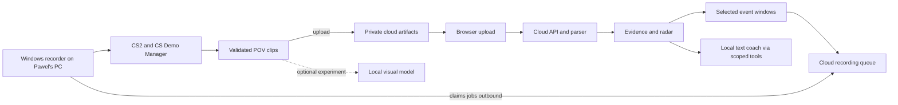

# Recording and training a grounded CS2 coach

Planning recommendation, 19 October 2026. This extends the [final delivery plan](FINAL-DELIVERY-PLAN.md); its RR task IDs remain authoritative. It does not claim that training, recording or dataset validation has already run.

## 1 Recommended approach

Build a telemetry-first coach: code extracts match evidence; the model requests relevant evidence through tools, retrieves reviewed CS2 knowledge and produces an explanation with citations. Render short POV clips for the user and human labellers. Test a vision-language model separately only if the core delivery is secure.

Fine-tuning should teach the model how to investigate and explain a CS2 situation, including when the evidence is insufficient. It should not be expected to discover sound coaching simply from millions of ticks or professional gameplay. A small reviewed dataset can test whether these behaviours improve; it cannot establish general expert-level coaching.

Keep these responsibilities separate:

| Layer | What it supplies | What it cannot establish alone |
|---|---|---|
| Parser and deterministic analysis | Events, timing, economy, equipment, positions and other actually available fields | Whether a decision was sensible or what a player knew |
| Reviewed knowledge retrieval | Map callouts, mechanics and conditional tactical principles | What happened in this particular match |
| Text model and tools | Evidence selection, contextual explanation, EN/PL answers and uncertainty | Missing line of sight, communications, intent or exact visual perception |
| Rendered POV and optional visual model | Additional visual context around a particular event | Perfect reconstruction of the player's experience or proof of the best decision |
| Human annotation | Evidence-grounded assessment, acceptable alternatives and disagreement | An infallible tactical oracle |

Do not penalise a player using hidden enemy positions that are visible only in spectator data. Record known information, unknown information and hindsight separately. A won fight can follow a poor decision; a sound decision can lose. Missing communications remain missing even if a model invents a plausible story.

## 2 Recording architecture

The cloud instance runs the API and parsing. It does not need Steam, CS2 or a GPU. Pawel's existing Windows machine renders clips in an interactive session; Aleksander requests and watches them through the shared application. A reliable unattended session is a preflight requirement, not something to assume from a successful manual recording. Visitors never supply Steam credentials.

Reuse the existing per-moment recording path in `apps/api/app/processing/moment_clips.py`. It already creates bounded windows and uses the video worker. Adapt this path to the outbound job contract rather than adding a separate training recorder. CS Demo Manager supports tick-defined sequences and focused player views; its Windows HLAE + FFmpeg path can avoid intermediate raw frames. Game updates can break recording compatibility, so record the tested versions. [CS Demo Manager video guide](https://cs-demo-manager.com/docs/guides/video)

Pawel implements and validates this sequence under RR03/RR20:

1. Start with one real demo per supported map. Manually render a known event, then repeat through the existing worker. Check the Windows session, Steam/game availability, CS:DM analysis state, seek and player focus before automating remote jobs.
2. Cloud analysis produces a typed request: owner, demo hash, match, player, round, start/end ticks, event anchor, capture profile and attempt ID. The worker downloads only its authorised input and validates the request. No free-form commands come from the model.
3. Begin with approximately 10–25 seconds per useful moment. Choose context before the decision and enough aftermath to understand it; extend toward 30–45 seconds when necessary within existing bounds. This is a proposed profile to measure, not a fixed definition of a tactical event.
4. Use a consistent first-person profile with x-ray disabled and documented HUD/radar/audio settings. Begin with 720p/60 fps for human review, then measure whether resolution or frame rate needs changing. Keep the original encoded clip; optional model frames are derived separately. Never use sparse frames to claim millisecond reaction accuracy.
5. Validate nonempty, decodable media, expected player, tick/time mapping and event alignment. Save checksums and provenance. Reuse the final plan's measured alignment gate. Publish only after validation, and show recording errors as errors rather than attaching an older clip.
6. Upload the private artifact and complete the lease. Restart, retry and cancellation must not mix attempts or kill unrelated user processes. Reuse a clip only when demo, player, window and capture-profile hashes match.
7. Measure queue wait, download, game startup/seek, capture, encode, upload, disk and GPU usage separately. Six 20-second clips total two minutes of output; that is not a promise of two minutes of processing.

One expensive GPU job runs at a time initially. Reserve recording batches and training windows with Aleksander. During training, model-dependent live requests can wait with a truthful state; cloud parsing and radar remain usable. Keep the known-good defence clips and inference configuration separate from experiments.

For annotation, inspect the full round through radar and request additional clips when necessary. Reviewing only the model's selected highlights would hide missed events and bias the labels. Rendered demo POV is a reconstruction: do not describe it as a recording of exactly what the player saw, heard or intended.

## 3 What to label yourselves

Use your own and invited players' permitted demos as the core corpus because these represent the users you intend to coach. Separate permission to process a demo from permission to reuse it for research/training. Keep identifiable data and clips in controlled storage; use pseudonymous references in training exports.

Retain the agreed 100-match target and 65/15/20 match split. Allocate the 150 annotated rounds as a proposed 90 train / 30 validation / 30 test distribution, with map and situation coverage in each. RR02 freezes the exact allocation before development begins. The 300 training conversations are derived only from training matches; they are not 300 independent matches or 300 independently observed situations.

Start with 30 training rounds, ten per map, independently labelled by both students. These are the agreed overlap labels, not an extra 30-round commitment. Compare labels, refine the rubric and retain original judgements alongside adjudication. Divide the remaining 120 rounds equally, giving each student 90 round reviews overall. Record review time in the pilot and adjust the schedule before scaling. Keep test annotations inaccessible to prompt/detector tuning.

Extend the existing `eval/label_tool.py` and `data/labels` format rather than building a new annotation application. Existing correct/wrong/unsure finding labels and missed-event entries remain useful, but they need the following coaching fields:

| Field | Labeller records |
|---|---|
| Identity and evidence | Match/split, map, player, round, event window, evidence IDs and optional clip/frame timestamps |
| Observed facts | What can be checked directly; whether a detector is correct, wrong or uncertain |
| Decision context | Economy, objective, time, teammates and information actually available; explicit missing context |
| Assessment | Helpful play, mistake, neutral or uncertain; decision quality separately from outcome |
| Explanation | Why the assessment follows from the evidence and assumptions; avoid claims about intent |
| Actionable alternative | One feasible next action or habit, with acceptable alternatives where tactics are ambiguous |
| Priority | Learning relevance/severity, confidence and whether this deserves a selected moment |
| Review | Independent labeller, disagreement, final review status and rubric version |

Include good plays, mundane rounds, false detector alarms and insufficient-evidence cases, not just deaths or dramatic mistakes. When a question cannot be answered, a correct target can be a qualified answer or a request for more context. Do not force every round into good/bad.

Illustrative annotation, not a claim about an inspected demo: “No teammate traded this death within the measured interval” can be supported by events. “Your teammate was close enough to trade” also needs timing, geometry and visibility; distance alone is insufficient. The advice should preserve that distinction.

Human review is the main quality bottleneck. Ideally ask an experienced player to review a small disputed subset during the invited study. Treat this as additional evidence, not a dependency or an implied promise of expert-labelled data. If only the two authors label, state that limitation. Report disagreement and unsure rates; do not quietly discard uncertainty from the study narrative.

## 4 Public datasets: useful inputs, not ready-made coaching answers

I found aligned CS2 gameplay datasets, but the sources checked do not supply ready-to-use human-validated answers to your full coaching task. Event labels such as a kill, movement action or round outcome are different from labels saying whether a decision was good and why.

| Source | Evidence and recommended role |
|---|---|
| [OpenCS2](https://huggingface.co/datasets/blanchon/opencs2_dataset) | Provides POV video with tick-aligned state/action data and event indices. Useful for a small visual/data-alignment experiment or additional human annotation. Its card lists renders/metadata as CC-BY-4.0 and says source demos remain subject to original tournament terms. Inspect metadata first and retrieve selected clips only. Do not bulk-download the corpus or assume automatic event labels are coaching truth. |
| [CounterStrike-1K](https://huggingface.co/datasets/ArnieRamesh/CounterStrike-1K/blob/main/README.md) | Provides synchronised professional POV/state data for world-model research. The card specifies noncommercial licensing and lists player profiling/ranking among out-of-scope uses. Keep it as a research reference; do not adopt it for personalised coaching training without resolving the stated use restrictions. |
| Your permitted matches | Primary source for the December experiment: known provenance, target-user relevance and labels built against your actual parser/tools. Retain independent validation/test matches. |
| Reviewed CS2 guides | Use supported extracts or original summaries in the knowledge base with source references; keep current tactical knowledge retrievable rather than trying to encode every map detail in model weights. |

Professional play can depend on team coordination unavailable in amateur matches. “Imitate a professional action” is therefore not automatically the right coaching target. Public data supplements your corpus; it does not remove human judgement or domain-shift evaluation.

Record source URL/version, permitted use, attribution and demo identity for every imported item. Keep translations, different POVs, clips, event variants and duplicate public copies of the same match in one split. A cross-match example may use only source matches from its assigned split; otherwise reject it. Split by match before creating examples.

## 5 Training data and code gaps to fix first

Teach a complete evidence-seeking interaction: user question -> appropriate tool call -> actual tool result -> optional knowledge retrieval -> concise grounded response. Training only polished answers would miss tool selection, argument correctness and interpretation of returned data. Use concise explanations, not invented hidden reasoning transcripts.

The inspected Studio `apps/api/app/services/dataset.py` is a useful starting point but is not ready for this experiment:

- It assigns an 80/10/10 hash split. Replace this with the frozen match manifest; reject missing or mixed-split provenance, including cross-match history.
- It exports `messages` but not the available tool schemas. Capture versioned schemas with traces and export them with each conversation.
- Its job allowlist does not include moment selection. Add reviewed selection trajectories if selection is a training objective. Keep deferred practice-plan features out of this December dataset.
- Its editor checks new citations/numbers against the original response/prompt. A correct human replacement needs validation against the actual tool evidence and knowledge passages, including correcting the original answer's citations.
- Passing citation/number checks is not semantic validation. Human reviewers must check tool arguments, interpretations, language and usefulness, not just accept model output that passed the verifier.
- Repaired traces can contain wrong assistant targets. Keep them excluded unless rebuilt as a clean, human-verified trajectory with real tool results. Preserve the rejected original in the audit record.

Aleksander leads this under RR24, with Pawel supporting trace/tool contracts under RR05/RR15. Export metadata should include all source match IDs, split, language, task, evidence/source versions, reviewer, model/prompt configuration and content hashes. Training never learns a fabricated tool result as fact.

Suggested allocation for the 300 accepted training conversations:

| Primary task | Target | Training signal |
|---|---:|---|
| Evidence-seeking questions | 100 | Correct tool choice/arguments, grounded answer and citations |
| Moment explanations | 100 | Good and poor decisions, useful alternatives and uncertainty |
| Moment selection | 60 | Supported ranking across multiple rounds without forced positives |
| Insufficient or misleading evidence | 40 | Abstention, correction of false premises and qualified advice |

Aim for balanced EN/PL coverage within each category. Review translations manually. A translated pair counts as two conversations but one underlying situation; report both counts. These are sampling targets to refine in RR02, not reasons to invent poor-quality examples to fill a quota. Both students review their allocated half; cross-review an initial subset and every disputed example.

For tool-use SFT, TRL expects conversation messages containing calls/results plus a `tools` schema column. Use the model's compatible chat template and check assistant-only training masks on a tokenised example, including tool-call targets; system/user/tool-result tokens should not become prediction targets. [TRL SFT documentation](https://huggingface.co/docs/trl/sft_trainer)

## 6 Fine-tuning experiment on the RTX 5080

Aleksander leads RR04/RR25/RR26/RR32. Treat these as bounded experiments with saved configurations:

1. **Establish the baseline first.** Compare deterministic templates and the existing text model with tools/RAG on validation situations. Inspect actual errors to decide which behaviours need training. Better evidence or retrieval can solve errors that fine-tuning cannot.
2. **Run a training smoke test early.** Use a small reviewed training subset, check CUDA/software compatibility, loss masks, memory and saved-adapter reload before curating all 300 examples. Preparation starts before the defence; do not replace the defence build.
3. **Start with a smaller checkpoint if necessary.** Try a 4B-class text model for the local pilot, then consider 8B/14B only after measurement. Inference of a quantised 14B model does not establish that training it fits. Use the original compatible training checkpoint with quantised loading, not the deployed GGUF file as training input.
4. **Use QLoRA.** PEFT documents four-bit loading and training adapters over a frozen quantised base. NF4 and double quantisation are supported options. [PEFT quantisation guide](https://huggingface.co/docs/peft/developer_guides/quantization)
5. **Measure a conservative configuration.** Suggested initial experiment: batch size 1, gradient accumulation/checkpointing, short complete trajectories around 1,024–2,048 tokens and small adapter rank. These are starting hypotheses, not verified hardware settings. Shorten tool output before truncating; never cut a call away from its result or answer. Record rejected overlong examples and test longer real requests separately.
6. **Choose on validation performance.** Bound the number of experiments and epochs in RR02, retain seeds/checkpoints and stop if overfitting or factual regressions appear. Falling training loss alone is not success. Keep tools, retrieval and decoding comparable between the base and tuned model.
7. **Verify the deployed variant.** Save adapter/tokenizer/template/config and reload them. Confirm the chosen model's export/serving path before spending on a full run. If conversion/quantisation is used, rerun tool/answer fixtures after it and evaluate that served artifact. Report export failure rather than treating a training checkpoint as a finished integration.
8. **Use larger rented/university hardware only if needed.** Prepare data and commands locally first. The optional GPU experiment remains within the $30 target unless separately agreed. Never rent solely because the first configuration ran out of memory.

When the pilot uses a smaller model, compare its base and tuned versions to isolate fine-tuning's effect. Report the original 14B baseline separately; comparing a tuned 4B model only against a base 14B model would confound model size with training.

The 20 November milestone is a measured training outcome, not a promise that fine-tuning wins. Prefer the base model for the product if the adapter hurts factuality or useful tool behaviour. The report still includes the documented experiment and its limitations.

## 7 Optional short-video experiment

Video analysis requires a vision-language model; the current text-only coach cannot consume frames directly. A small existing model such as [Qwen3-VL-4B-Instruct](https://huggingface.co/Qwen/Qwen3-VL-4B-Instruct) is a candidate for image/video input, not a verified CS2 specialist or a guaranteed memory fit. Do not add vision fine-tuning to the December commitments.

Use OPT03 only after the next P0 gate is secure. Cap the first investigation at two working sessions. Select 30 development clips, ten per map, with visual questions that telemetry cannot directly settle: apparent obstruction, exposed positions or coarse crosshair placement. Include ambiguous clips and blinded human answers. Start with a bounded short sequence or 8–16 timestamped frames; document sampling and what it can miss.

Compare telemetry/tools/RAG alone against the same context plus visual observations. Record correct observations, unsupported claims, usefulness, latency and peak VRAM. This pilot is exploratory and does not use the final test set. If results justify further work, define a separate untouched validation sample and acceptance criterion before testing it; otherwise defer integration.

If integrated later, expose a scoped clip/frame tool and preserve visual timestamps, model version and uncertainty. A visual model's description is an additional fallible observation, not a replacement for parsed event facts. Disagreement should trigger a qualification or human inspection. Do not infer precise reaction time, invisible communications or intent from sampled frames. Keep per-frame identifiers distinct from deterministic evidence IDs so citations do not imply equal reliability.

## 8 Assigned work and handoffs

These expand existing rows rather than create a competing backlog.

| Task and target | Pawel | Aleksander | Completion evidence |
|---|---|---|---|
| RR02/RR03/RR04, 22 Oct | Three-map recording/parser preflight; measure costs and resources | Rubric/split protocol, baseline tools/RAG and training environment preflight | Measured samples, fixed protocol, known blockers |
| RR05, 23 Oct | Define clip/tick/evidence/trace contracts | Define training provenance and tool-schema requirements | Shared fixtures and versioned fields |
| RR12, 6 Nov | Label overlap and half the remaining rounds | Lead corpus, label overlap and other half, preserve disagreements | 150 unique rounds, 30 overlap, sealed test material |
| RR20, 11 Nov | Outbound recorder, private upload, clip manifest and alignment | Check clips support annotation and expected evidence | Real aligned clips on all maps; recovery evidence |
| RR24, 14 Nov | Support evidence/schema exporter fixes; review allocated examples | Lead exporter correction and 300 accepted conversations | Manifest-controlled export; valid tools; no held-out leakage |
| RR25, 20 Nov | Reserve GPU windows; retain defence build | QLoRA, reload/export and validation comparisons | Reproducible result, including failure if applicable |
| OPT03, before 24 Nov only if P0 secure | Supply existing clips | Lead bounded visual-model probe | Measured value/cost decision; default defer product integration |
| RR32, 28 Nov | Blind ratings and reproducibility review | Frozen held-out comparisons and error analysis | Base versus tuned at same size; raw metrics and uncertainty |

By the first defence, show a real telemetry-grounded explanation and its clip, plus the labelling/training method and interim baseline measurements. By 6 December, deliver the working invited-user product and honest evidence about whether fine-tuning improved it. Full-match visual analysis and training a game-playing/world model are outside this plan.

Only planning documents were changed for this work. No dataset was downloaded, model trained, recorder launched or cloud service provisioned.
